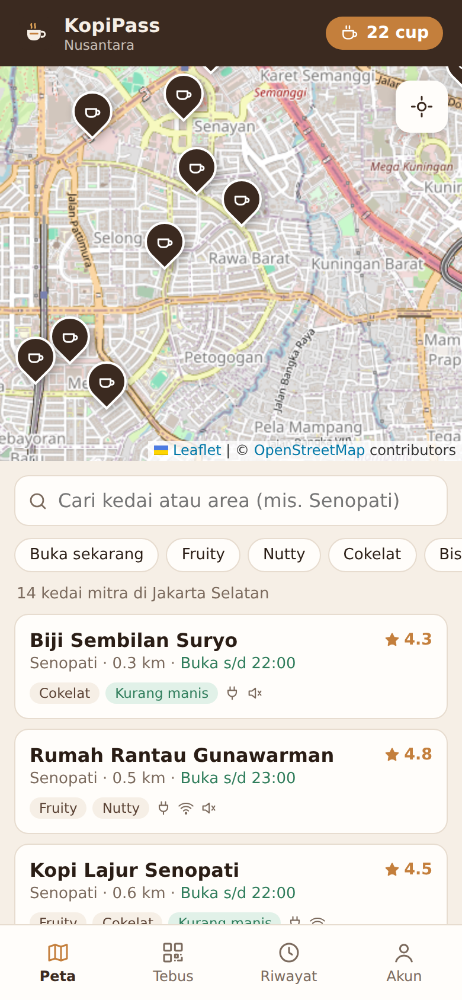
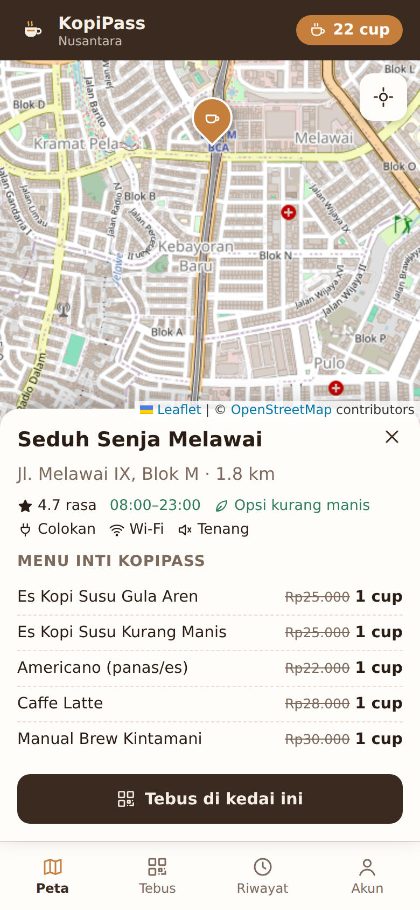
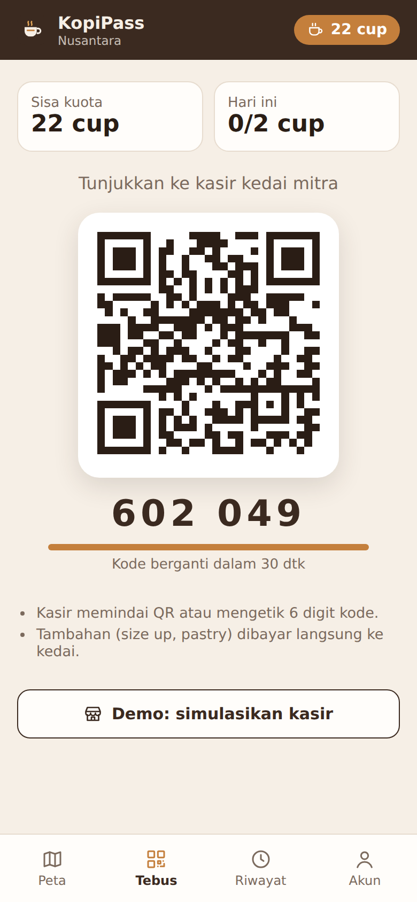
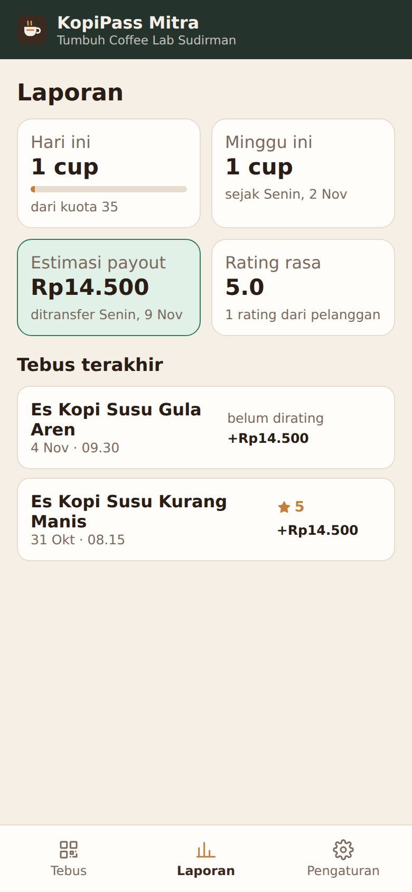
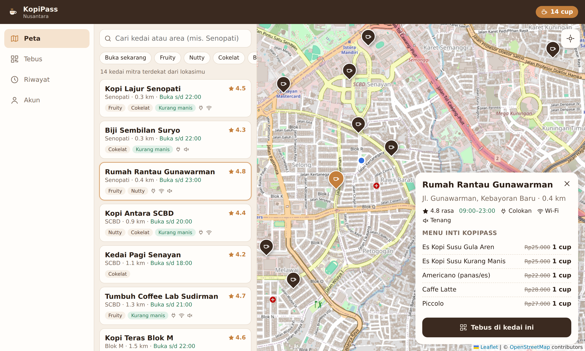

<p align="center">
  
</p>

<h1 align="center">KopiPass Nusantara</h1>

<p align="center"><b>Satu langganan, ratusan kedai lokal, kopi harian lebih hemat.</b></p>

<p align="center">
  <a href="https://github.com/yudhis7/coffeepassnusantara/actions/workflows/build.yml"></a>
  
  
</p>

<p align="center">
  <b>Project Ideation &amp; Lead: <a href="https://github.com/yudhis7">@yudhis7</a></b>
</p>

---

KopiPass Nusantara adalah langganan bulanan berisi kuota cup kopi yang bisa ditebus di jaringan kedai kopi lokal, dengan harga per cup 28–40% lebih murah dari harga menu. Kedai mitra dibayar Rp14.500 per cup yang ditebus setiap minggu, tanpa biaya bergabung.

| Masalah pelanggan | Jawaban KopiPass |
| --- | --- |
| Kopi harian mahal (Rp25 ribu × 22 hari = Rp550 ribu/bulan) | Paket Harian 22 cup Rp349.000 |
| Promo terpecah di banyak aplikasi brand | Satu aplikasi untuk banyak kedai |
| Sulit memilih di antara ratusan ribu gerai | Peta dengan filter rasa, kadar manis, dan fasilitas kerja |
| Kedai independen kalah promosi | Kedai tampil di peta dan mendapat pelanggan tanpa biaya iklan |

## Tampilan aplikasi

<p align="center">
  
  
  
  
</p>
<p align="center">
  
</p>

## Unduh

Buka **[Releases](https://github.com/yudhis7/coffeepassnusantara/releases)** dan pilih:

| Platform | File |
| --- | --- |
| Android | `KopiPass-Nusantara-x.y.z-android.apk` |
| Windows (instal) | `KopiPass-Nusantara-Setup-x.y.z.exe` |
| Windows (tanpa instal) | `KopiPass-Nusantara-Portable-x.y.z.exe` |

Cara memasang dan memakai aplikasi ada di **[Panduan Pengguna](docs/USER_GUIDE.md)**.

> Ini prototipe: data tersimpan di perangkat, nama kedai fiktif, dan tidak ada pembayaran sungguhan. OTP demo `123456`, PIN mitra demo `1234`.

## Fitur prototipe

**Pelanggan**
- Daftar dengan nomor WhatsApp + OTP
- Pilih paket (Hemat, Harian, Harian Plus) dan metode autodebit
- Peta kedai mitra dengan pin, lokasi pengguna, pencarian, dan filter (buka sekarang, rasa, kurang manis, colokan, Wi-Fi, tenang)
- Detail kedai dan daftar menu inti
- QR + kode tebus dinamis yang berganti setiap 30 detik
- Rating rasa, riwayat tebus, pause/batal langganan

**Mitra (kasir kedai)**
- Masuk dengan PIN staf per kedai
- Konfirmasi tebus dengan validasi lengkap (kode, kuota, batas harian, jeda per kedai, kuota harian kedai)
- Laporan harian/mingguan dan estimasi payout
- Atur kuota harian dan matikan sementara penerimaan KopiPass

## Dokumentasi

| Dokumen | Isi |
| --- | --- |
| [docs/SOP.md](docs/SOP.md) | SOP dan workflow operasional: onboarding kedai, tebus, payout, kualitas, fraud, CS |
| [docs/USER_GUIDE.md](docs/USER_GUIDE.md) | Panduan pengguna bergambar untuk pelanggan dan mitra |
| [docs/FRAMEWORK.md](docs/FRAMEWORK.md) | Arsitektur target, model data, pemetaan prototipe ke API |
| [CONTRIBUTORS.md](CONTRIBUTORS.md) | Penggagas dan kontributor |

## Struktur repository

```
coffeepassnusantara/
├── app/                      # Aplikasi (satu basis kode untuk Android, Windows, web)
│   ├── src/                  # React + TypeScript
│   │   ├── screens/          # Layar pelanggan & mitra
│   │   ├── components/       # Peta, ikon, modal rating
│   │   ├── data/             # Data kedai contoh & paket
│   │   └── store.ts          # Mock backend (diganti API asli nanti)
│   ├── android/              # Proyek Android (Capacitor)
│   ├── electron/             # Pembungkus Windows (Electron)
│   └── scripts/              # Screenshot otomatis & pembuat ikon
├── docs/                     # SOP, panduan pengguna, framework, gambar
└── .github/workflows/        # Build APK + installer Windows, screenshot otomatis
```

## Menjalankan dari kode

Butuh Node.js 20+.

```bash
cd app
npm install
npm run dev            # versi web di http://localhost:5173
```

| Target | Perintah | Kebutuhan |
| --- | --- | --- |
| Windows installer | `npm run dist:win` | Dijalankan di Windows |
| Android APK | `npm run android:sync` lalu `cd android && ./gradlew assembleDebug` | Android SDK + Java 17 |
| Screenshot panduan | `npm run build && npm run screenshots` | Playwright Chromium |

Tanpa menyiapkan apa pun di komputer, GitHub Actions membangun APK dan installer Windows setiap ada perubahan di folder `app/`. Untuk membuat rilis baru, buat tag versi:

```bash
git tag v0.1.1 && git push origin v0.1.1
```

## Roadmap singkat

1. Validasi pasar di klaster Jakarta Selatan (Blok M, Senopati, SCBD, Kuningan)
2. Backend API + integrasi payment gateway
3. Pindai QR dengan kamera dan validasi lokasi di aplikasi mitra
4. Pilot 50 kedai dan 1.000 pelanggan

## Kredit

- **Project Ideation & Lead:** [yudhis7](https://github.com/yudhis7)
- Peta: © [OpenStreetMap](https://www.openstreetmap.org/copyright) contributors (ubin standar OSM untuk prototipe; untuk produksi set `VITE_TILE_URL` ke penyedia ubin berlisensi)

## Lisensi

Hak cipta © 2026 yudhis7. Seluruh hak dilindungi. Lisensi open source belum ditetapkan.
