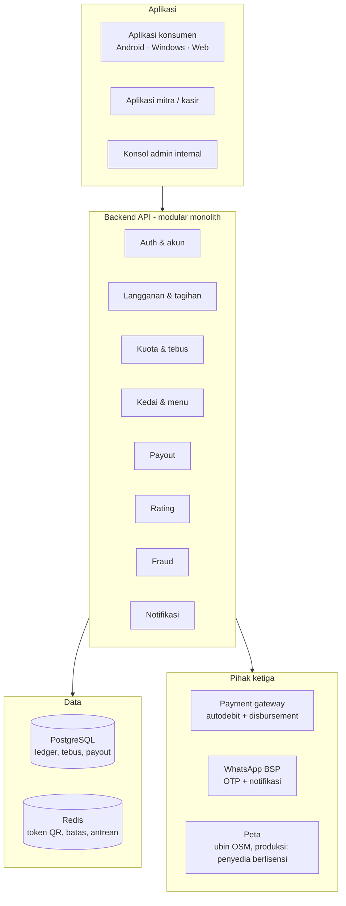

# Framework Aplikasi KopiPass Nusantara

Ringkasan arsitektur target dan posisi prototipe di repository ini. Pemilik dokumen: **yudhis7**.

## Status saat ini

Repository ini berisi **prototipe front-end** yang sudah bisa dipasang di Android dan Windows. Backend masih ditiru di perangkat (`app/src/store.ts`) supaya alur lengkap bisa dicoba tanpa server. Setiap fungsi di file tersebut memetakan satu endpoint API target di bawah, jadi penggantian ke backend asli dilakukan tanpa mengubah layar.

## Arsitektur target

Prinsip desain:

- **Kuota sebagai buku besar (ledger).** Sisa kuota = jumlah semua baris `quota_ledger`, tidak disimpan sebagai angka yang ditimpa.
- **Tebus ≤ 3 detik di kasir.** Validasi dilakukan dalam satu panggilan dan satu transaksi database.
- **Satu basis kode untuk semua platform.** React + Vite, dibungkus Capacitor (Android) dan Electron (Windows).

## Teknologi prototipe

| Bagian | Teknologi |
| --- | --- |
| UI | React 18 + TypeScript, Vite |
| Peta | Leaflet + React-Leaflet, ubin OpenStreetMap (bisa diganti lewat `VITE_TILE_URL`) |
| QR tebus | qrcode.react |
| Android | Capacitor 6 (APK dibangun di GitHub Actions) |
| Windows | Electron 33 + electron-builder (installer NSIS dan portable) |
| Screenshot panduan | Playwright (`app/scripts/screenshots.mjs`) |

## Pemetaan fungsi prototipe ke API target

| Fungsi di `store.ts` | Endpoint target | Keterangan |
| --- | --- | --- |
| `login` | `POST /auth/otp`, `POST /auth/verify` | OTP lewat WhatsApp, ikat perangkat |
| `subscribe` | `POST /subscriptions` | Tagihan berulang di payment gateway, lalu `grant` kuota |
| `togglePause`, `cancelSubscription` | `POST /subscriptions/{id}/pause`, `/cancel` | |
| `quotaLeft`, `cupsToday` | `GET /me/quota` | Dihitung dari ledger |
| `createToken` | `POST /redeem/token` | Token sekali pakai 30 detik, ditandatangani server |
| `confirmRedeem` | `POST /redeem/confirm` | Validasi lengkap + tulis `redemption` dan ledger `-1` |
| `rate` | `POST /redemptions/{id}/rating` | |
| `mitraLogin` | `POST /auth/staff` | PIN staf per gerai |
| `setOutletCap`, `toggleOutletPause` | `PATCH /outlets/{id}/settings` | |
| `outletToday`, `outletWeek` | `GET /merchant/summary` | Estimasi payout mingguan |

## Model data inti

| Entitas | Field utama |
| --- | --- |
| `user` | id, no_hp, nama, profil_selera |
| `subscription` | id, user_id, plan_id, status, periode_mulai, periode_akhir |
| `quota_ledger` | id, subscription_id, delta, jenis (grant/redeem/rollover/expire/compensation/referral) |
| `outlet` | id, merchant_id, alamat, lat, lng, jam_buka, kuota_harian, tag_wfc |
| `menu_item` | id, outlet_id, nama, harga_normal, menu_inti |
| `redemption` | id, user_id, outlet_id, menu_item_id, staff_id, token_id, payout_amount, status |
| `payout` | id, merchant_id, periode, total_cup, total_amount, status |
| `rating` | id, redemption_id, skor, tag |

## Langkah berikutnya

1. Backend NestJS + PostgreSQL dengan endpoint di atas.
2. Pindai QR dengan kamera di aplikasi mitra.
3. Validasi lokasi (geofence ±150 m) saat tebus.
4. Integrasi payment gateway untuk autodebit dan payout.
5. Rilis APK bertanda tangan (release keystore) dan installer Windows bersertifikat.
