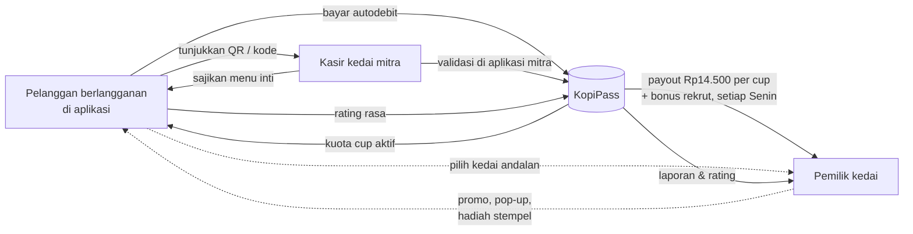
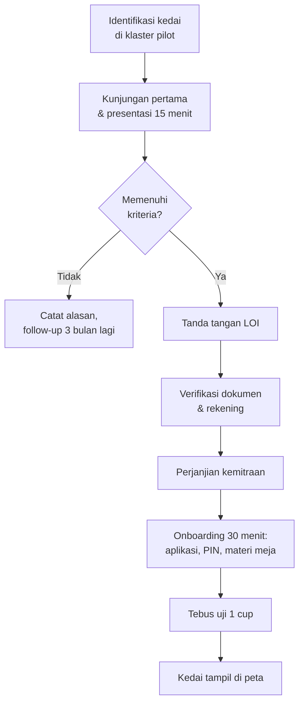
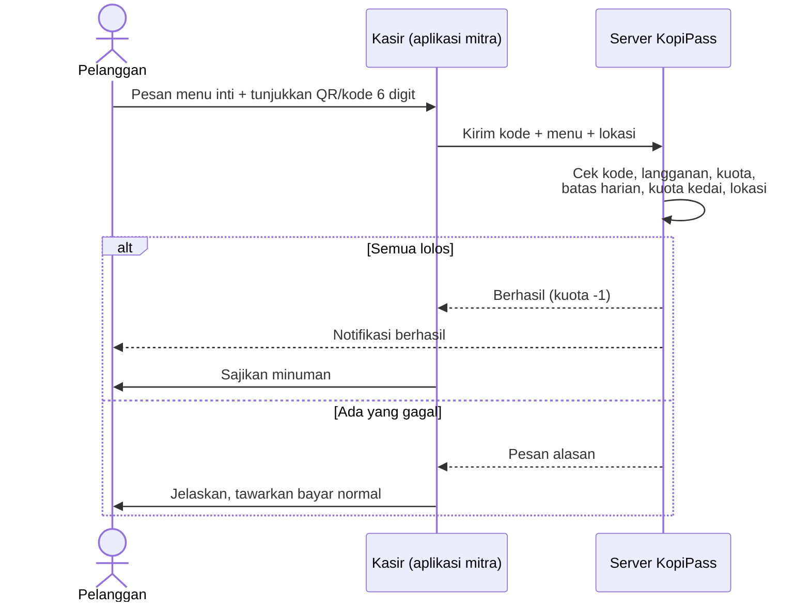
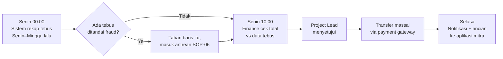
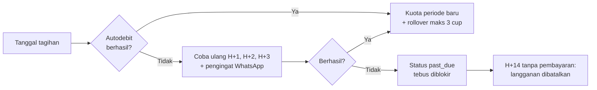
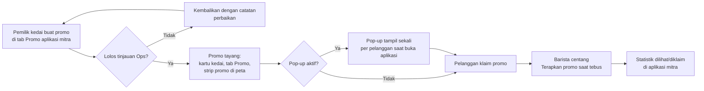

# SOP & Workflow Operasional KopiPass Nusantara

Versi 0.2 · November 2026 · Pemilik dokumen: **yudhis7** (Project Ideation & Lead)

Dokumen ini mengatur cara kerja harian KopiPass selama fase pilot di Jakarta Selatan: merekrut kedai, melayani pelanggan, menebus cup di kasir, membayar kedai, menjaga kualitas, dan menangani kecurangan. Setiap SOP berisi pemicu, langkah, penanggung jawab, dan batas waktu (SLA).

## Daftar isi

1. [Peran dan tanggung jawab](#1-peran-dan-tanggung-jawab)
2. [Gambaran alur bisnis](#2-gambaran-alur-bisnis)
3. [SOP-01 Rekrutmen dan onboarding kedai mitra](#sop-01-rekrutmen-dan-onboarding-kedai-mitra)
4. [SOP-02 Pendaftaran dan langganan pelanggan](#sop-02-pendaftaran-dan-langganan-pelanggan)
5. [SOP-03 Tebus cup di kasir](#sop-03-tebus-cup-di-kasir)
6. [SOP-04 Payout mingguan ke kedai](#sop-04-payout-mingguan-ke-kedai)
7. [SOP-05 Kontrol kualitas dan mystery shopper](#sop-05-kontrol-kualitas-dan-mystery-shopper)
8. [SOP-06 Deteksi dan penanganan kecurangan](#sop-06-deteksi-dan-penanganan-kecurangan)
9. [SOP-07 Layanan pelanggan, refund, dan kompensasi](#sop-07-layanan-pelanggan-refund-dan-kompensasi)
10. [SOP-08 Tagihan gagal, pause, dan pembatalan](#sop-08-tagihan-gagal-pause-dan-pembatalan)
11. [SOP-09 Offboarding kedai mitra](#sop-09-offboarding-kedai-mitra)
12. [SOP-10 Rapat dan laporan KPI mingguan](#sop-10-rapat-dan-laporan-kpi-mingguan)
13. [SOP-11 Promo mitra dan pop-up](#sop-11-promo-mitra-dan-pop-up)
14. [SOP-12 Kedai andalan, kartu stempel, dan cup bonus](#sop-12-kedai-andalan-kartu-stempel-dan-cup-bonus)
15. [Lampiran: parameter operasional](#lampiran-parameter-operasional)

---

## 1. Peran dan tanggung jawab

| Peran | Siapa | Tanggung jawab utama |
| --- | --- | --- |
| Project Lead | yudhis7 (founder) | Keputusan harga, paket, ekspansi; menyetujui payout dan pengecualian |
| Partnership & Ops | 1–2 orang | Rekrut dan latih kedai, mystery shopper, hubungan harian dengan mitra |
| Customer Service (CS) | Ops merangkap saat pilot | Menjawab pelanggan di WhatsApp/aplikasi, refund, kompensasi cup |
| Finance | Founder merangkap saat pilot | Rekonsiliasi tagihan, eksekusi payout, pajak |
| Engineer | 2 orang | Menjaga aplikasi, aturan anti-fraud, data laporan |
| Mitra – pemilik kedai | Pemilik | Menjaga resep dan kualitas, mengatur kuota harian, menerima payout |
| Mitra – barista/kasir | Staf kedai | Memvalidasi tebus di aplikasi mitra, melayani pelanggan KopiPass |

Matriks RACI ringkas (R = mengerjakan, A = bertanggung jawab akhir, C = dikonsultasikan, I = diberi tahu):

| Proses | Project Lead | Partnership & Ops | CS | Finance | Engineer | Mitra |
| --- | --- | --- | --- | --- | --- | --- |
| Onboarding kedai | A | R | I | C | C | R |
| Tebus di kasir | I | C | C | – | C | R/A |
| Payout mingguan | A | C | – | R | C | I |
| Mystery shopper | I | R/A | – | – | – | I |
| Review fraud | A | R | C | C | R | I |
| Refund & kompensasi | C | C | R/A | R | – | – |
| Review promo mitra | A | R | I | C | – | R |
| Hadiah stempel & cup bonus | I | C | C | R | C | R/A |

---

## 2. Gambaran alur bisnis

Siklus mingguan tim:

| Hari | Kegiatan |
| --- | --- |
| Senin 00.00 | Sistem merekap tebus pekan lalu (SOP-04) |
| Senin 10.00 | Review fraud dan persetujuan payout |
| Selasa | Payout ditransfer ke semua kedai |
| Rabu–Kamis | Kunjungan mystery shopper dan kedai baru (SOP-01, SOP-05) |
| Jumat 15.00 | Rapat KPI mingguan (SOP-10) |
| Setiap hari | CS aktif 07.00–21.00 WIB (SOP-07) |

---

## SOP-01 Rekrutmen dan onboarding kedai mitra

**Pemicu:** target jumlah kedai di klaster belum tercapai, atau ada kedai yang mendaftar.
**Penanggung jawab:** Partnership & Ops. **Target:** kedai aktif ≤ 7 hari kerja sejak setuju.

**Kriteria kedai mitra**

- Kedai independen atau jaringan kecil (1–10 gerai) di klaster pilot.
- Rating Google ≥ 4,3 atau lolos uji rasa oleh tim.
- Sanggup menyediakan minimal 4 menu inti (harga normal ≤ Rp30.000), termasuk satu opsi kurang manis.
- Jam buka minimal 8 jam per hari, 6 hari per minggu.
- Punya rekening bank atas nama usaha atau pemilik.

**Langkah**

1. **Identifikasi (H-14).** Ops memetakan kedai di klaster lewat Google Maps dan kunjungan, lalu mencatatnya di pipeline (nama, kontak, status).
2. **Kunjungan pertama.** Presentasikan model: payout Rp14.500 per cup, tanpa biaya bergabung, kedai mengatur kuota harian dan jam aktif. Bawa contoh laporan payout.
3. **LOI.** Kedai yang tertarik menandatangani surat minat (LOI) satu halaman.
4. **Verifikasi.** Kumpulkan: KTP pemilik, NIB (jika ada), foto buku rekening, foto menu dan harga, foto tampak depan kedai.
5. **Perjanjian kemitraan.** Isi pokok: payout per cup, jadwal transfer, standar resep, aturan mystery shopper, syarat keluar. Ditandatangani kedua pihak.
6. **Onboarding di kedai (30 menit).**
    - Pasang aplikasi mitra di HP kasir dan buat PIN untuk setiap barista.
    - Atur menu inti, kuota harian awal (disarankan 30 cup), dan jam aktif.
    - Tempel stiker QR KopiPass di kasir dan materi meja.
    - Latih barista dengan SOP-03, termasuk cara menangani pesan error.
7. **Tebus uji.** Ops menebus 1 cup dengan akun uji; pastikan muncul di laporan kedai.
8. **Aktivasi.** Engineer/Ops mengaktifkan kedai di peta. Kirim pesan sambutan berisi kontak Ops dan jadwal payout.

**Checklist onboarding**

- [ ] LOI dan perjanjian kemitraan ditandatangani
- [ ] Rekening terverifikasi (nama sesuai)
- [ ] Minimal 4 menu inti terdaftar, termasuk opsi kurang manis
- [ ] Semua barista punya PIN dan sudah dilatih
- [ ] Stiker QR dan materi meja terpasang
- [ ] Tebus uji berhasil dan muncul di laporan
- [ ] Kedai tampil di peta dengan foto, jam buka, dan tag WFC yang benar

---

## SOP-02 Pendaftaran dan langganan pelanggan

**Penanggung jawab:** sistem (otomatis), CS untuk kendala.

1. Pelanggan mengunduh aplikasi, membaca nilai KopiPass di halaman awal, mengisi nama dan nomor WhatsApp, lalu memverifikasi OTP.
2. Pelanggan langsung bisa **menjelajah tanpa berlangganan**: melihat peta kedai, menyimpan favorit, dan mengklaim promo.
3. Langganan dimulai dari salah satu pintu: tombol **Mulai langganan**, tab **Tebus**, tombol **Langganan lewat kedai ini** di kartu kedai, atau pop-up promo kedai.
4. Pelanggan memilih paket: Hemat (10 cup, Rp179.000), Harian (22 cup, Rp349.000), atau Harian Plus (30 cup, Rp449.000), dan **boleh memilih kedai andalan** (opsional, lihat SOP-12).
5. Pelanggan memilih metode autodebit (GoPay, OVO, DANA, atau kartu) dan menyetujui syarat.
6. Setelah pembayaran berhasil, sistem mengaktifkan langganan, menambahkan kuota umum, dan bila ada promo langganan dari kedai andalan, menambahkan **cup bonus kedai**.
7. Sistem mengirim pesan sambutan berisi cara menebus, kedai andalan, dan 3 kedai terdekat.

**Aturan yang harus dijelaskan ke pelanggan:** maksimal 2 cup per hari; 1 cup per kedai setiap 3 jam; sisa kuota maksimal 3 cup dibawa ke periode berikutnya; satu akun untuk satu orang dan satu perangkat.

**Kendala umum**

| Masalah | Tindakan CS |
| --- | --- |
| OTP tidak masuk | Minta cek nomor; kirim ulang setelah 60 detik; maksimal 3 kali, lalu verifikasi manual |
| Bayar berhasil tapi kuota belum aktif | Cek status di konsol admin; jika webhook gagal, aktifkan manual dan catat di log |
| Ingin ganti paket | Berlaku mulai periode berikutnya; naik paket bisa langsung dengan selisih prorata |

---

## SOP-03 Tebus cup di kasir

**Penanggung jawab:** barista/kasir. **Target:** ≤ 3 detik per validasi, ≤ 30 detik total di kasir.

**Langkah barista**

1. Sapa pelanggan dan tanyakan menu. Pastikan menu yang dipilih adalah **menu inti** KopiPass.
2. Minta pelanggan membuka tab **Tebus** di aplikasinya.
3. Di aplikasi mitra, ketik 6 digit kode di bawah QR (atau pindai QR bila fitur kamera sudah aktif).
4. Baca **panel pelanggan** yang muncul setelah kode diketik: nama, level member di kedai ini, badge **Andalan**, sisa cup bonus kedai, hadiah stempel, dan promo yang sudah diklaim.
    - Jika hadiah stempel siap dan pelanggan memintanya, centang **Berikan hadiah stempel** dan siapkan hadiahnya (ditanggung kedai).
    - Jika pelanggan menunjukkan promo yang sudah diklaim, centang **Terapkan promo** dan berikan potongan/item sesuai promo.
    - Pelanggan berbadge **Andalan** atau level **Sahabat Kedai** disapa dengan nama: merekalah inti pelanggan setia kedai.
5. Pilih menu inti yang dipesan, lalu tekan **Konfirmasi**.
6. Tunggu tanda centang hijau "Berhasil". Baru setelah itu buat minuman.
7. Tambahan (size up, extra shot, pastry, menu non-inti) ditagih langsung dengan harga normal lewat kasir kedai, dikurangi promo bila diterapkan.
8. Buat minuman dengan resep dan ukuran yang **sama persis** dengan pembeli biasa.

**Pesan error dan tindakan**

| Pesan di aplikasi mitra | Arti | Tindakan barista |
| --- | --- | --- |
| Kode tidak ditemukan | Kode salah ketik atau sudah berganti | Minta pelanggan menunjukkan kode terbaru |
| Kode sudah kedaluwarsa | Kode berlaku 30 detik | Minta pelanggan menunggu kode baru, ketik ulang |
| Kode ini sudah dipakai | Kode sudah ditebus | Jangan layani gratis; minta kode baru |
| Kuota cup bulan ini sudah habis | Kuota pelanggan nol | Tawarkan bayar normal |
| Kuota umum habis. Cup bonus pelanggan hanya berlaku di kedai lain | Pelanggan hanya punya cup bonus dari kedai lain | Tawarkan bayar normal |
| Batas 2 cup per hari sudah tercapai | Batas harian pelanggan | Tawarkan bayar normal |
| Sudah menebus di kedai ini dalam 3 jam terakhir | Aturan jeda per kedai | Tawarkan bayar normal |
| Kuota harian KopiPass kedai ini sudah penuh | Kuota kedai habis | Tawarkan bayar normal; pemilik bisa menambah kuota di Pengaturan |
| KopiPass sedang dinonaktifkan | Kedai mematikan sementara | Aktifkan di Pengaturan bila memungkinkan |

**Larangan:** menebus tanpa pelanggan hadir, menebus menu non-inti sebagai menu inti, mencatat tebus untuk akun yang sama berulang kali, atau menyajikan ukuran/resep berbeda. Pelanggaran ditangani lewat SOP-06.

---

## SOP-04 Payout mingguan ke kedai

**Penanggung jawab:** Finance (R), Project Lead (A). **SLA:** dana diterima kedai paling lambat Selasa.

**Langkah**

1. **Rekap otomatis (Senin 00.00).** Sistem menghitung per kedai:
    - tebus dari kuota umum × Rp14.500;
    - tebus dari **cup bonus kedai** × Rp0 (cup bonus ditanggung kedai pemberinya, lihat SOP-12);
    - **bonus rekrut** Rp20.000 untuk setiap pelanggan baru yang berlangganan lewat kedai tersebut pada pekan itu (usulan, berlaku setelah pelanggan lolos masa refund 3 hari).
2. **Cek fraud (Senin 09.00).** Baris tebus yang ditandai ditahan dan diselesaikan lewat SOP-06 dalam 5 hari kerja. Payout yang ditahan dibayarkan pekan berikutnya jika dinyatakan sah.
3. **Rekonsiliasi (Senin 10.00).** Finance mencocokkan total payout dengan jumlah tebus di database dan memastikan rekening tujuan tidak berubah tanpa verifikasi.
4. **Persetujuan.** Project Lead menyetujui rekap di konsol admin.
5. **Transfer (Senin sore–Selasa).** Eksekusi transfer massal lewat layanan disbursement. Transfer gagal dicoba ulang sekali; jika tetap gagal, Ops menghubungi kedai untuk memperbarui rekening.
6. **Konfirmasi.** Kedai menerima notifikasi dan rincian per hari di aplikasi mitra.

**Sengketa payout:** kedai mengajukan lewat Ops paling lambat 14 hari setelah transfer. Finance menjawab dalam 3 hari kerja dengan data tebus per transaksi.

---

## SOP-05 Kontrol kualitas dan mystery shopper

**Penanggung jawab:** Partnership & Ops.

1. Setiap kedai dikunjungi mystery shopper **1 kali per bulan** pada jam acak, dengan akun pelanggan biasa.
2. Penilaian (skor 1–5): rasa sesuai standar kedai, ukuran sama dengan pembeli biasa, sikap barista, kecepatan tebus, ketersediaan opsi kurang manis.
3. Mystery shopper juga membeli 1 menu yang sama dengan bayar normal untuk dibandingkan.
4. Hasil dicatat di konsol admin dalam 24 jam.

**Tindak lanjut**

| Kondisi | Tindakan |
| --- | --- |
| Skor rata-rata ≥ 4 | Tidak ada tindakan; kirim apresiasi |
| Skor 3–3,9 atau ukuran/resep berbeda sekali | Peringatan tertulis + kunjungan ulang dalam 2 minggu |
| Pelanggaran berulang atau rating pelanggan < 4,0 selama 3 bulan | Proses SOP-09 (offboarding) |

---

## SOP-06 Deteksi dan penanganan kecurangan

**Penanggung jawab:** Ops + Engineer (R), Project Lead (A). **SLA:** review selesai ≤ 5 hari kerja.

**Sinyal yang ditandai otomatis**

- Satu akun menebus di dua kedai yang berjauhan dalam waktu tidak wajar.
- Lokasi HP pelanggan atau kasir di luar radius ±150 m dari kedai.
- Kedai dengan lonjakan tebus di luar jam ramai atau banyak tebus dari akun baru.
- Satu barista dengan rasio tebus jauh di atas rekan sekedai.
- Satu perangkat dipakai untuk banyak akun.

**Langkah**

1. Sistem menandai tebus dan menahan payout baris tersebut.
2. Ops memeriksa data: waktu, lokasi, staf, riwayat akun.
3. Bila perlu, Ops menghubungi pelanggan dan/atau pemilik kedai untuk klarifikasi.
4. Keputusan dicatat: **sah** (payout dilepas), **tidak sah** (tebus dibatalkan, kuota dikembalikan ke pelanggan jika ia korban), atau **kecurangan disengaja**.
5. Sanksi kecurangan disengaja: akun pelanggan diblokir; kedai mendapat peringatan tertulis untuk pelanggaran pertama dan dikeluarkan untuk pelanggaran kedua.

---

## SOP-07 Layanan pelanggan, refund, dan kompensasi

**Kanal:** WhatsApp resmi dan menu bantuan di aplikasi. **Jam layanan:** 07.00–21.00 WIB.

| Prioritas | Contoh | Respons pertama | Selesai |
| --- | --- | --- | --- |
| P1 – sedang di kasir | Tebus gagal padahal kuota ada | ≤ 5 menit | ≤ 30 menit |
| P2 – uang/kuota | Tertagih dua kali, kuota tidak masuk | ≤ 1 jam | ≤ 1 hari kerja |
| P3 – umum | Ganti paket, saran kedai, ganti perangkat | ≤ 4 jam | ≤ 2 hari kerja |

**Kebijakan kompensasi**

- Tebus gagal karena gangguan sistem dan pelanggan terpaksa membayar: kembalikan **1 cup** ke kuota (jenis `compensation`).
- Minuman tidak sesuai standar dan dilaporkan dengan foto ≤ 24 jam: kembalikan 1 cup, teruskan ke Ops untuk SOP-05.
- Tertagih dua kali: refund penuh tagihan ganda ≤ 3 hari kerja.
- Batal di 3 hari pertama tanpa menebus satu cup pun: refund penuh. Setelah itu tidak ada refund; langganan berjalan sampai akhir periode.

Setiap kompensasi dan refund dicatat di konsol admin beserta alasannya.

---

## SOP-08 Tagihan gagal, pause, dan pembatalan

- **Pause:** maksimal 1 bulan per tahun; tidak ditagih selama pause; sisa kuota dibekukan.
- **Batal:** bisa kapan saja sebelum tanggal tagihan; kuota tetap bisa dipakai sampai akhir periode.
- **Win-back:** pelanggan yang batal menerima survei singkat alasan batal. Pelanggan yang batal karena harga ditawari paket Hemat.

---

## SOP-09 Offboarding kedai mitra

**Pemicu:** permintaan kedai, pelanggaran berulang (SOP-05/06), atau kedai tutup.

1. Ops mengonfirmasi alasan dan tanggal efektif (pemberitahuan minimal 7 hari, kecuali kecurangan).
2. Kedai dinonaktifkan dari peta pada tanggal efektif.
3. Payout terakhir dihitung sampai tanggal efektif dan dibayar di siklus Senin berikutnya.
4. Akses aplikasi mitra dan PIN staf dicabut.
5. Pelanggan yang sering menebus di kedai itu diberi tahu dan direkomendasikan kedai terdekat lain.
6. Materi KopiPass di kedai diambil kembali.

---

## SOP-10 Rapat dan laporan KPI mingguan

**Waktu:** Jumat 15.00, 45 menit. **Peserta:** seluruh tim inti. **Pemimpin:** Project Lead.

| KPI | Target pilot | Sumber |
| --- | --- | --- |
| Pelanggan aktif berbayar | 1.000 pada Mar 2027 | Konsol admin |
| Kedai mitra aktif | 50 | Konsol admin |
| Tingkat tebus rata-rata | ≤ 80% kuota | Data tebus |
| Churn bulanan | ≤ 15% | Data langganan |
| CAC campuran | ≤ Rp150.000 | Pemasaran + data daftar |
| Kedai bertahan setelah 3 bulan | ≥ 70% | Data mitra |
| Rating rasa rata-rata | ≥ 4,3 | Rating pelanggan |
| Tiket CS P1 selesai ≤ 30 menit | ≥ 95% | Log CS |

**Agenda:** KPI vs target (10 menit) → masalah kedai dan hasil mystery shopper (10 menit) → kasus fraud dan CS (10 menit) → keputusan dan tindakan minggu depan (15 menit). Notulen dan daftar tindakan disimpan di folder bersama tim.

---

## SOP-11 Promo mitra dan pop-up

**Tujuan:** memberi kedai alat untuk menarik pelanggan berlangganan lewat kedainya, mengisi jam sepi, dan merawat pelanggan andalan, tanpa merusak pengalaman pelanggan.
**Penanggung jawab:** pemilik kedai (membuat), Partnership & Ops (meninjau), Project Lead (menyetujui pengecualian). **SLA tinjauan:** ≤ 1 hari kerja.

**Jenis promo yang tersedia**

| Jenis | Cara kerja | Siapa yang menanggung |
| --- | --- | --- |
| Bonus langganan lewat kedai | Pelanggan baru yang berlangganan lewat kedai mendapat 1–5 cup bonus yang hanya bisa ditebus di kedai itu; kedai otomatis menjadi kedai andalannya | Kedai (cup bonus tanpa payout) |
| Diskon tambahan member | Diskon untuk pembelian tambahan (pastry, biji kopi, menu non-inti) | Kedai |
| Jam sepi: stempel ganda | Tebus pada jam yang dipilih memberi stempel tambahan | Kedai (hadiah stempel lebih cepat tercapai) |
| Upgrade / item gratis | Size up, oat milk, extra shot, atau item kecil saat menebus | Kedai |

**Aturan promo**

1. Promo ditanggung kedai. KopiPass tidak mengubah payout Rp14.500 untuk cup dari kuota umum.
2. Promo tidak boleh menurunkan standar minuman inti (ukuran, resep, kualitas).
3. Judul maksimal 60 karakter dan deskripsi maksimal 200 karakter, jelas, tanpa klaim berlebihan, dengan tanggal berakhir.
4. **Maksimal 1 pop-up aktif per kedai.** Aplikasi menampilkan paling banyak 1 pop-up per sesi pelanggan, dengan prioritas kedai andalan, lalu kedai favorit.
5. Bonus langganan maksimal 5 cup per pelanggan dan hanya untuk pelanggan baru.
6. Promo untuk "pelanggan andalan" hanya terlihat bisa diklaim oleh pelanggan yang menjadikan kedai itu kedai andalan.

**Langkah tinjauan Ops**

1. Cek kesesuaian isi dengan aturan di atas dan kesanggupan kedai menanggung promo selama periode berlaku.
2. Untuk bonus langganan, pastikan kedai memahami bahwa cup bonus **tidak dibayar** KopiPass.
3. Setujui, atau kembalikan dengan catatan. Promo yang disetujui tayang otomatis.
4. Pantau mingguan: promo dengan banyak keluhan atau rasio klaim/dipakai yang janggal dinonaktifkan dan dibahas dengan kedai.

---

## SOP-12 Kedai andalan, kartu stempel, dan cup bonus

**Tujuan:** mengikat pelanggan ke kedai tertentu sehingga kedai mendapat pelanggan tetap dan pelanggan merasa dikenali.
**Penanggung jawab:** sistem (perhitungan), barista (pemberian hadiah), Finance (cup bonus dan bonus rekrut di payout).

**Mekanisme**

| Mekanisme | Aturan |
| --- | --- |
| Kedai andalan | Satu per pelanggan. Dipilih saat berlangganan, dari kartu kedai, atau otomatis saat berlangganan lewat promo kedai. Bisa diganti dari tab Kedaiku. |
| Kartu stempel | Ada di setiap kedai. Tebus biasa = 1 stempel; di kedai andalan = 2 stempel; jam sepi promo = +1 stempel. Jumlah stempel per hadiah (2–20) dan hadiahnya diatur kedai. |
| Level member per kedai | Dihitung dari jumlah cup di kedai itu: Pengunjung (0–4), Langganan (5–14), Sahabat Kedai (15+). Tampil di aplikasi pelanggan dan di panel kasir. |
| Cup bonus kedai | Dari promo bonus langganan. Hanya bisa ditebus di kedai pemberinya, dipakai lebih dulu daripada kuota umum saat menebus di sana, tanpa payout. Hangus jika langganan berakhir. |
| Bonus rekrut | Kedai menerima Rp20.000 per pelanggan baru yang berlangganan lewat kedainya (usulan), dibayar bersama payout mingguan. |

**Langkah barista saat hadiah stempel siap**

1. Panel pelanggan menampilkan "Berikan hadiah stempel: [hadiah]".
2. Tanyakan apakah pelanggan ingin memakai hadiahnya sekarang.
3. Jika ya, centang kotaknya sebelum menekan **Konfirmasi**, lalu berikan hadiah.
4. Stempel berkurang sesuai target; stempel sisa tetap tersimpan.

**Kendala umum**

| Masalah | Tindakan |
| --- | --- |
| Pelanggan ingin ganti kedai andalan | Bisa dari tab Kedaiku. Stempel dan level di kedai lama tetap tersimpan; cup bonus tetap hanya berlaku di kedai pemberinya. |
| Pelanggan merasa stempel kurang | CS cek riwayat tebus (stempel tercatat per transaksi) dan beri kompensasi stempel bila ada kesalahan sistem. |
| Kedai ingin mengubah hadiah | Ubah di Atur → Kartu stempel. Perubahan berlaku untuk stempel berikutnya; hadiah yang sudah siap tetap dihormati. |

---

## Lampiran: parameter operasional

| Parameter | Nilai pilot |
| --- | --- |
| Payout ke kedai | Rp14.500 per cup |
| Batas tebus pelanggan | 2 cup per hari; 1 cup per kedai per 3 jam |
| Masa berlaku kode tebus | 30 detik, sekali pakai |
| Rollover kuota | Maksimal 3 cup |
| Kuota harian kedai (default) | 30 cup, diatur pemilik |
| Radius validasi lokasi | ±150 m |
| Jadwal payout | Rekap Senin 00.00, transfer paling lambat Selasa |
| Mystery shopper | 1 kali per kedai per bulan |
| Jam CS | 07.00–21.00 WIB |
| Cup bonus kedai | Payout Rp0, hanya di kedai pemberi, maks. 5 cup per pelanggan baru |
| Bonus rekrut kedai | Rp20.000 per pelanggan baru via kedai (usulan) |
| Stempel per tebus | 1; kedai andalan 2; jam sepi promo +1 |
| Level member | Pengunjung 0–4, Langganan 5–14, Sahabat Kedai 15+ cup |
| Pop-up promo | Maks. 1 aktif per kedai; maks. 1 tampil per sesi pelanggan |

Semua angka adalah asumsi pilot dan dapat diubah oleh Project Lead berdasarkan data.
