# Panduan Pengguna KopiPass Nusantara

Versi aplikasi 0.1.0 (prototipe) · Untuk Android dan Windows

KopiPass memberi kamu kuota cup kopi bulanan yang bisa ditebus di kedai-kedai mitra. Panduan ini menjelaskan cara memasang aplikasi, memakai aplikasi sebagai **pelanggan**, dan memakai mode **mitra (kasir kedai)**.

> **Catatan prototipe.** Versi ini belum terhubung ke server. Semua data (akun, kuota, riwayat) tersimpan di perangkat masing-masing, nama kedai adalah contoh fiktif, dan tidak ada pembayaran sungguhan. Kode OTP demo: **123456**. PIN mitra demo: **1234**.

## Daftar isi

- [Memasang aplikasi](#memasang-aplikasi)
- [Bagian A — Pelanggan](#bagian-a--pelanggan)
  1. [Daftar dan masuk](#1-daftar-dan-masuk)
  2. [Memilih paket langganan](#2-memilih-paket-langganan)
  3. [Mencari kedai di peta](#3-mencari-kedai-di-peta)
  4. [Melihat detail kedai](#4-melihat-detail-kedai)
  5. [Menebus cup di kasir](#5-menebus-cup-di-kasir)
  6. [Memberi rating rasa](#6-memberi-rating-rasa)
  7. [Riwayat dan akun](#7-riwayat-dan-akun)
- [Bagian B — Mitra (kasir kedai)](#bagian-b--mitra-kasir-kedai)
- [Bagian C — Tampilan Windows](#bagian-c--tampilan-windows)
- [Pertanyaan umum dan solusi masalah](#pertanyaan-umum-dan-solusi-masalah)

---

## Memasang aplikasi

File instalasi tersedia di halaman **Releases** repository ini (atau di tab **Actions → Build aplikasi → Artifacts** untuk versi terbaru).

### Android

1. Unduh file `KopiPass-Nusantara-x.y.z-android.apk` di ponsel.
2. Buka file tersebut. Jika muncul peringatan, pilih **Setelan → Izinkan dari sumber ini** (izin "Instal aplikasi tidak dikenal").
3. Tekan **Instal**, lalu **Buka**.
4. Saat diminta, izinkan akses **lokasi** agar aplikasi bisa menampilkan kedai terdekat.

Membutuhkan Android 5.1 atau lebih baru dan koneksi internet untuk memuat peta.

### Windows

Ada dua pilihan file:

| File | Kapan dipakai |
| --- | --- |
| `KopiPass-Nusantara-Setup-x.y.z.exe` | Instalasi biasa (ada di Start Menu dan bisa di-uninstall) |
| `KopiPass-Nusantara-Portable-x.y.z.exe` | Langsung jalan tanpa instalasi, cocok untuk dicoba dari flashdisk |

Karena prototipe belum memakai sertifikat code signing, Windows SmartScreen mungkin menampilkan "Windows protected your PC". Klik **More info → Run anyway**.

---

## Bagian A — Pelanggan

### 1. Daftar dan masuk

| Layar sambutan | Isi data | Verifikasi OTP |
| :---: | :---: | :---: |
|  |  |  |

1. Di layar sambutan, tekan **Mulai**. (Pemilik atau barista kedai menekan **Saya pemilik / barista kedai mitra**, lihat [Bagian B](#bagian-b--mitra-kasir-kedai).)
2. Isi **nama panggilan** dan **nomor WhatsApp** tanpa angka 0 di depan (contoh: `812xxxxxxxx`), lalu tekan **Kirim kode OTP**.
3. Masukkan 6 digit kode OTP dan tekan **Verifikasi**. Di versi demo, kodenya selalu `123456`.

### 2. Memilih paket langganan

| Pilihan paket | Konfirmasi dan pembayaran |
| :---: | :---: |
| 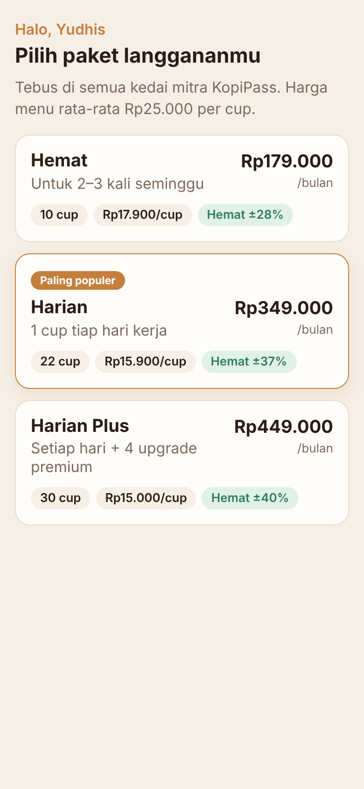 | 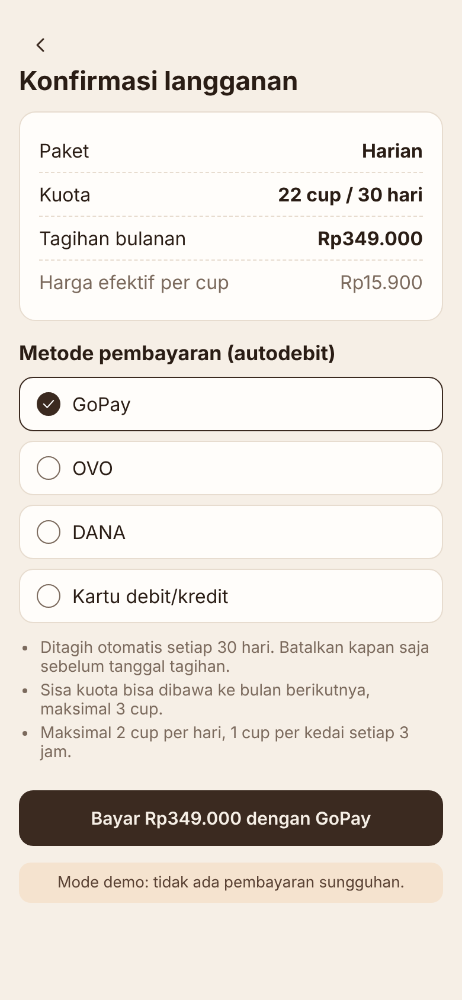 |

1. Pilih paket yang sesuai kebiasaan minum kopimu:

    | Paket | Kuota | Harga per bulan | Per cup |
    | --- | --- | --- | --- |
    | Hemat | 10 cup | Rp179.000 | Rp17.900 |
    | Harian (paling populer) | 22 cup | Rp349.000 | Rp15.900 |
    | Harian Plus | 30 cup | Rp449.000 | Rp15.000 |

2. Di layar konfirmasi, pilih metode autodebit (GoPay, OVO, DANA, atau kartu).
3. Baca aturan singkatnya, lalu tekan **Bayar**. Kuota langsung aktif dan terlihat di pojok kanan atas (misalnya **22 cup**).

**Aturan penting:** maksimal 2 cup per hari, 1 cup per kedai setiap 3 jam, dan sisa kuota maksimal 3 cup dibawa ke bulan berikutnya.

### 3. Mencari kedai di peta

| Peta dan daftar kedai | Memakai filter dan lokasi |
| :---: | :---: |
| 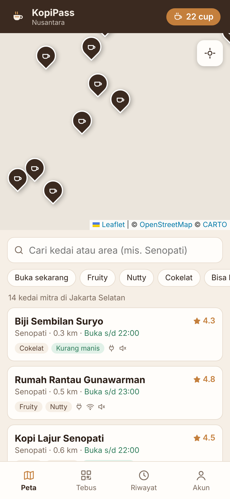 | 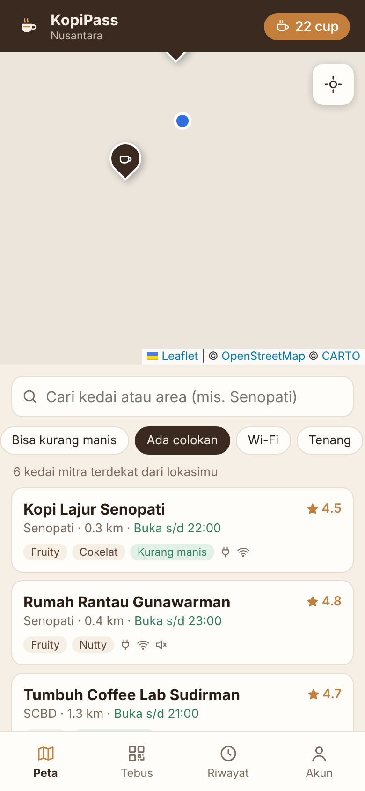 |

- **Pin cokelat** di peta adalah kedai mitra. Pin abu-abu berarti kedai sedang tutup. Daftar di bawah peta diurutkan dari yang terdekat.
- Tekan tombol **lokasi** (ikon bidik di kanan atas peta) untuk menampilkan posisimu sebagai **titik biru** dan mengurutkan kedai dari lokasimu.
- Ketik nama kedai atau area (misalnya *Senopati*) di kotak pencarian.
- Tekan **filter** untuk menyaring kedai. Filter bisa digabung:

    | Filter | Artinya |
    | --- | --- |
    | Buka sekarang | Hanya kedai yang sedang buka |
    | Fruity / Nutty / Cokelat | Profil rasa kopi andalan kedai |
    | Bisa kurang manis | Kedai menyediakan opsi kopi susu kurang manis |
    | Ada colokan / Wi-Fi / Tenang | Cocok untuk kerja (WFC) |

- Ikon kecil di kartu kedai menunjukkan fasilitas: colokan, Wi-Fi, dan suasana tenang.

### 4. Melihat detail kedai

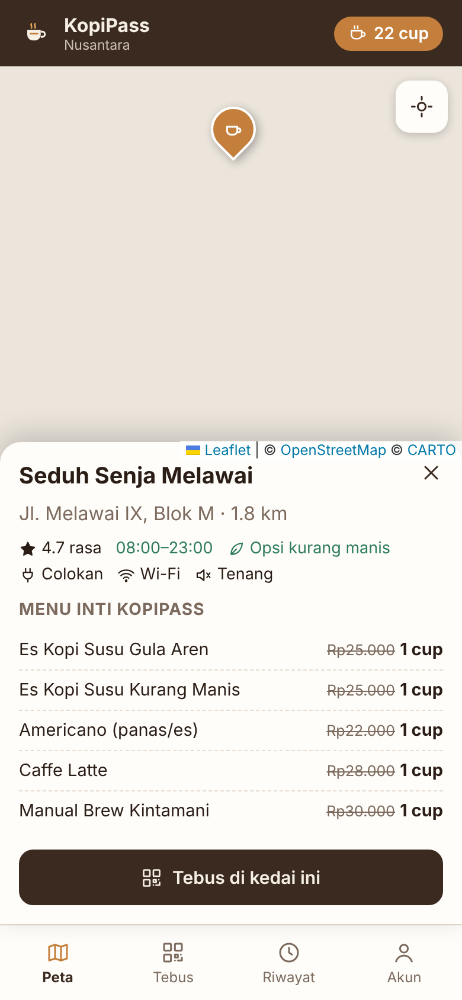

Tekan pin di peta atau kartu di daftar untuk membuka detail kedai:

- Alamat, jarak, jam buka, rating rasa, dan fasilitas.
- **Menu inti KopiPass**: menu yang bisa ditebus dengan 1 cup. Harga normalnya dicoret sebagai pembanding. Menu berwarna abu-abu bukan menu inti dan dibayar normal.
- Tekan **Tebus di kedai ini** untuk langsung membuka layar tebus.

### 5. Menebus cup di kasir

| QR dan kode tebus | Simulasi kasir (demo) | Berhasil |
| :---: | :---: | :---: |
| 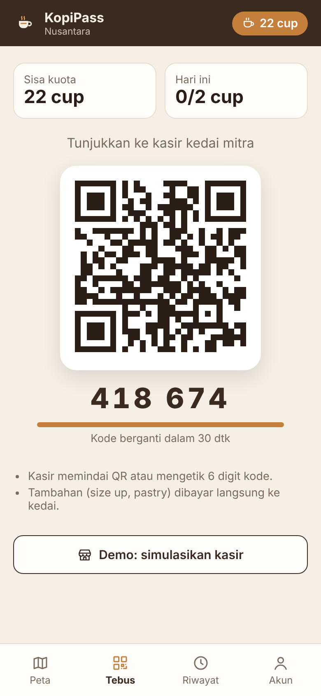 | 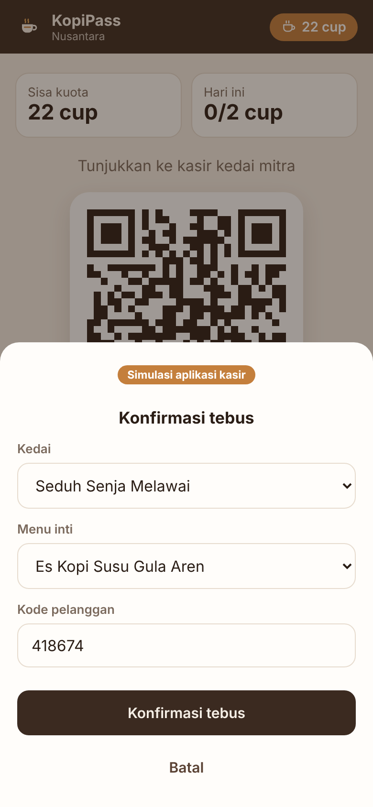 | 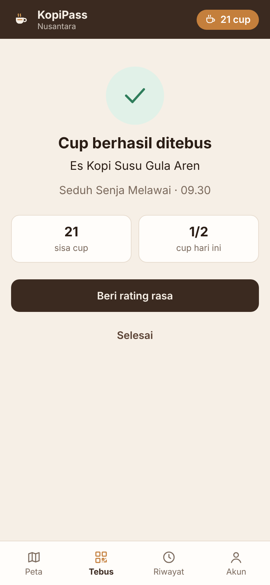 |

1. Di kasir, pesan salah satu **menu inti**.
2. Buka tab **Tebus**. Aplikasi menampilkan **QR** dan **kode 6 digit**.
3. Tunjukkan layar ke kasir. Kasir memasukkan kode di aplikasi mitranya.
4. Kode berganti otomatis setiap **30 detik** demi keamanan. Bila kasir terlambat, cukup tunjukkan kode terbaru.
5. Setelah kasir mengonfirmasi, layar berubah menjadi **Cup berhasil ditebus** dan kuota berkurang satu.
6. Tambahan seperti size up atau pastry dibayar langsung ke kedai.

**Mencoba sendiri tanpa kasir:** tekan **Demo: simulasikan kasir**, pilih kedai dan menu, lalu tekan **Konfirmasi tebus**. Ini meniru apa yang dilakukan barista.

Jika tombol tebus tidak muncul, aplikasi menampilkan alasannya, misalnya kuota habis, batas 2 cup per hari tercapai, atau langganan sedang di-pause.

### 6. Memberi rating rasa

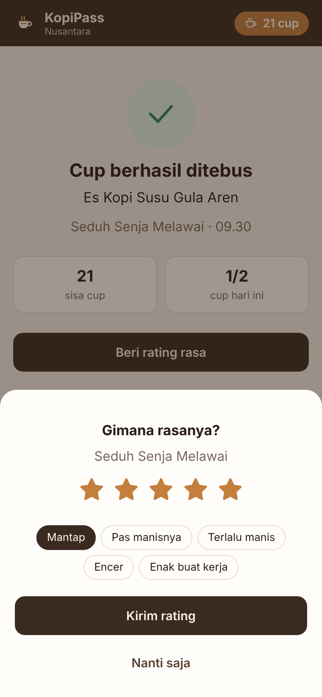

Setelah menebus, tekan **Beri rating rasa**. Pilih jumlah bintang dan tag yang sesuai (misalnya *Mantap*, *Pas manisnya*, *Terlalu manis*), lalu **Kirim rating**. Rating membantu pelanggan lain memilih kedai dan membantu kedai menjaga kualitas.

### 7. Riwayat dan akun

| Riwayat tebus | Akun dan langganan |
| :---: | :---: |
| 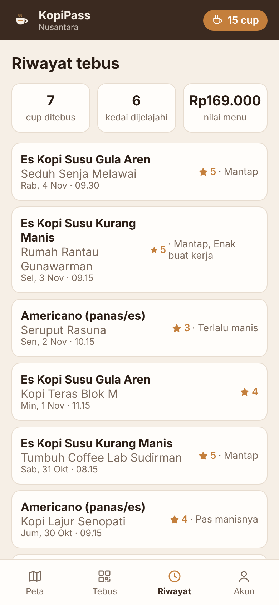 | 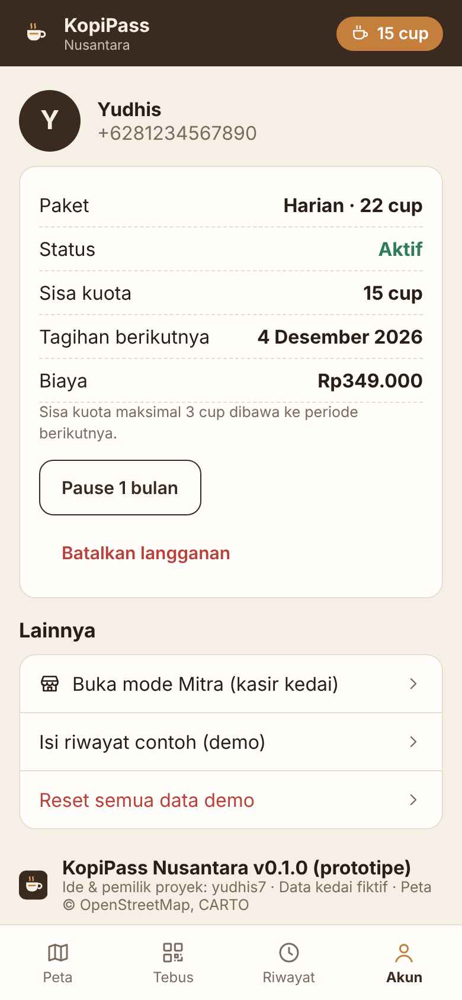 |

- **Riwayat** menampilkan semua cup yang ditebus, jumlah kedai yang sudah dijelajahi, dan total nilai menu. Cup yang belum dirating punya tombol **Beri rating**.
- **Akun** menampilkan paket, status, sisa kuota, dan tanggal tagihan berikutnya. Di sini kamu bisa:
    - **Pause 1 bulan** (tidak ditagih selama pause) atau **Batalkan langganan**.
    - **Buka mode Mitra** untuk mencoba aplikasi kasir.
    - **Isi riwayat contoh** untuk melihat tampilan riwayat yang terisi (khusus demo).
    - **Reset semua data demo** untuk mengulang dari awal.

---

## Bagian B — Mitra (kasir kedai)

Mode mitra dipakai pemilik dan barista di HP atau komputer kasir.

| Masuk sebagai mitra | Konfirmasi tebus |
| :---: | :---: |
| 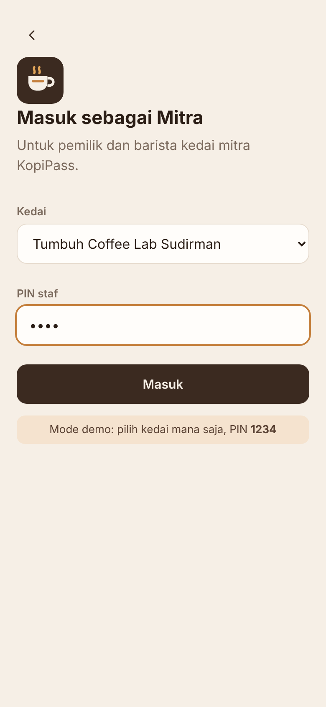 | 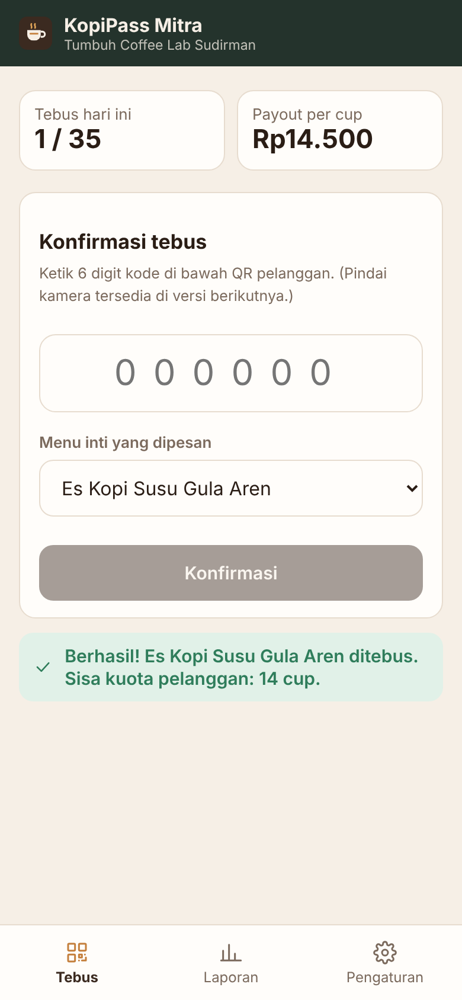 |

### Masuk

1. Dari layar sambutan, tekan **Saya pemilik / barista kedai mitra** (atau dari **Akun → Buka mode Mitra**).
2. Pilih **kedai** dan masukkan **PIN staf** (demo: `1234`), lalu tekan **Masuk**.

### Menebus cup pelanggan

1. Minta pelanggan membuka tab **Tebus** di aplikasinya.
2. Ketik **6 digit kode** yang tampil di bawah QR pelanggan.
3. Pilih **menu inti** yang dipesan, lalu tekan **Konfirmasi**.
4. Tunggu pesan hijau **Berhasil**, baru buat minumannya dengan resep dan ukuran yang sama seperti pembeli biasa.
5. Jika muncul pesan merah, ikuti petunjuknya. Contoh: *Kode sudah kedaluwarsa* berarti minta kode terbaru; *Kuota cup bulan ini sudah habis* berarti tawarkan bayar normal. Daftar lengkap ada di [SOP-03](SOP.md#sop-03-tebus-cup-di-kasir).

### Laporan dan pengaturan

| Laporan | Pengaturan kedai |
| :---: | :---: |
| 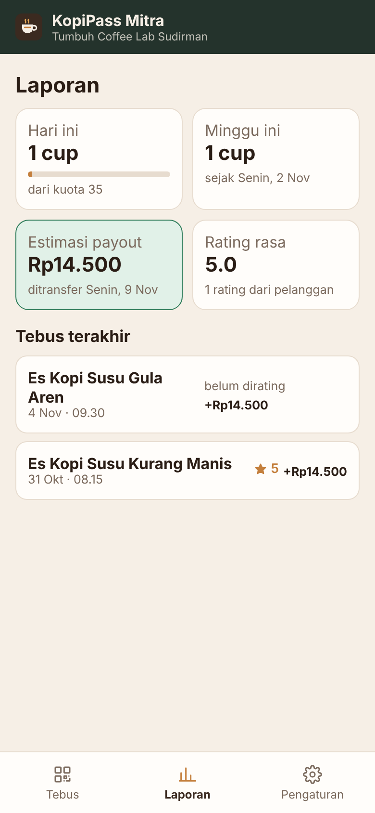 | 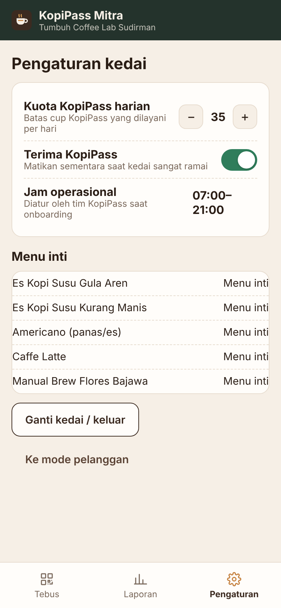 |

- **Laporan** menampilkan tebus hari ini dibanding kuota harian, tebus minggu ini, **estimasi payout** (Rp14.500 per cup, ditransfer setiap Senin), rata-rata rating rasa, dan daftar tebus terakhir.
- **Pengaturan** untuk:
    - Mengatur **kuota KopiPass harian** dengan tombol − dan +.
    - Mematikan sementara **Terima KopiPass** saat kedai sangat ramai.
    - Melihat jam operasional dan daftar menu inti.
    - **Ganti kedai / keluar**, atau kembali ke mode pelanggan.

---

## Bagian C — Tampilan Windows

| Peta dengan daftar dan detail kedai | Riwayat |
| :---: | :---: |
| 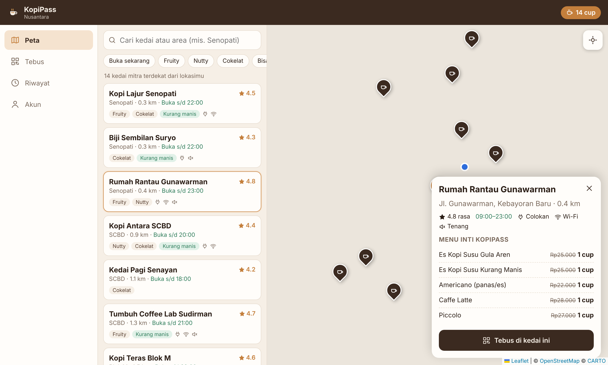 | 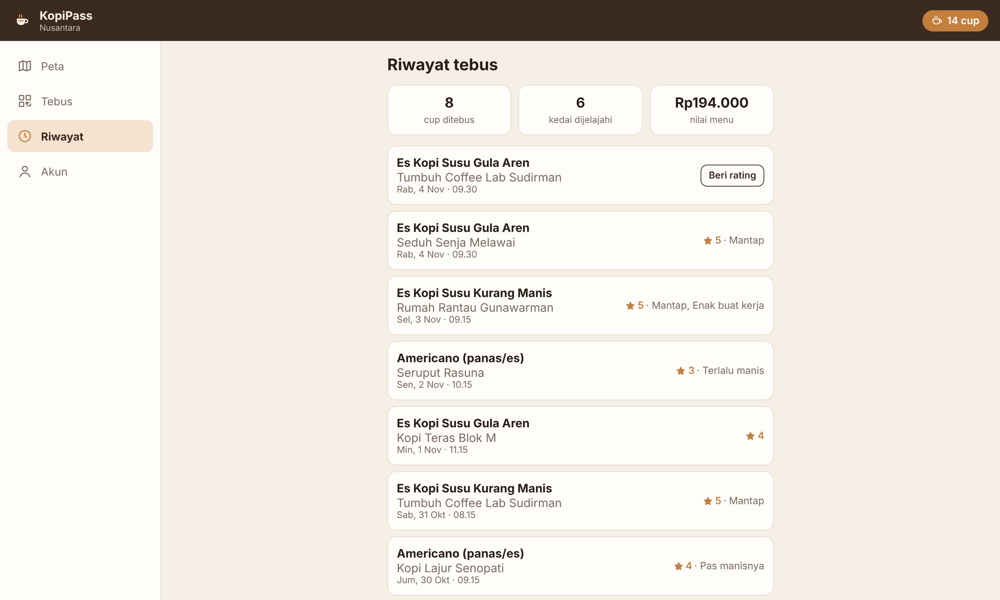 |

Di Windows (dan di layar lebar), menu pindah ke sisi kiri, daftar kedai tampil di samping peta, dan detail kedai muncul sebagai panel di kanan peta. Semua fungsi sama dengan versi ponsel. Jendela bisa diperkecil sampai seukuran ponsel dan tampilan akan menyesuaikan.

---

## Pertanyaan umum dan solusi masalah

| Masalah | Solusi |
| --- | --- |
| Peta abu-abu dan tidak ada jalan | Peta membutuhkan internet. Periksa koneksi lalu buka ulang tab Peta. Pin kedai tetap tampil walau peta belum termuat. |
| Titik biru lokasi tidak muncul | Izinkan akses lokasi: Android **Setelan → Aplikasi → KopiPass → Izin → Lokasi**; Windows **Settings → Privacy & security → Location**. |
| "Kode sudah kedaluwarsa" di kasir | Kode berlaku 30 detik. Tunjukkan kode terbaru yang tampil di layar. |
| "Batas 2 cup per hari sudah tercapai" | Batas harian per akun. Kuota bisa dipakai lagi besok. |
| "Sudah menebus di kedai ini dalam 3 jam terakhir" | Aturan jeda per kedai. Tebus di kedai lain atau tunggu 3 jam. |
| "Kuota harian KopiPass kedai ini sudah penuh" | Kedai sudah mencapai batas harian. Pilih kedai lain di peta. |
| Data di HP dan laptop berbeda | Di prototipe, data tersimpan per perangkat. Sinkronisasi akan tersedia setelah backend aktif. |
| Ingin mengulang demo dari awal | **Akun → Reset semua data demo**. |

Butuh bantuan lain? Hubungi pemilik proyek melalui halaman GitHub [yudhis7](https://github.com/yudhis7).
