# Panduan Pengguna KopiPass Nusantara

Versi aplikasi 0.2.0 (prototipe) · Untuk Android dan Windows

KopiPass memberi kamu kuota cup kopi bulanan yang bisa ditebus di kedai-kedai mitra, sekaligus mengikatmu dengan **kedai andalan**: kedai yang memberimu stempel ganda, level member, cup bonus, dan promo khusus. Panduan ini menjelaskan cara memasang aplikasi, memakai aplikasi sebagai **pelanggan**, dan memakai mode **mitra (kasir dan pemilik kedai)**.

> **Catatan prototipe.** Versi ini belum terhubung ke server. Semua data (akun, kuota, stempel, promo) tersimpan di perangkat masing-masing, nama kedai dan pelanggan contoh adalah fiktif, dan tidak ada pembayaran sungguhan. Kode OTP demo: **123456**. PIN mitra demo: **1234**.

## Daftar isi

- [Memasang aplikasi](#memasang-aplikasi)
- [Bagian A — Pelanggan](#bagian-a--pelanggan)
  1. [Halaman awal dan masuk](#1-halaman-awal-dan-masuk)
  2. [Pop-up promo dari kedai](#2-pop-up-promo-dari-kedai)
  3. [Berlangganan lewat kedai andalan](#3-berlangganan-lewat-kedai-andalan)
  4. [Kedaiku: kedai andalan, stempel, dan level](#4-kedaiku-kedai-andalan-stempel-dan-level)
  5. [Menjelajah kedai di peta](#5-menjelajah-kedai-di-peta)
  6. [Promo dari kedai](#6-promo-dari-kedai)
  7. [Menebus cup di kasir](#7-menebus-cup-di-kasir)
  8. [Rating, riwayat, dan akun](#8-rating-riwayat-dan-akun)
- [Bagian B — Mitra (kasir dan pemilik kedai)](#bagian-b--mitra-kasir-dan-pemilik-kedai)
- [Bagian C — Tampilan Windows](#bagian-c--tampilan-windows)
- [Pertanyaan umum dan solusi masalah](#pertanyaan-umum-dan-solusi-masalah)

---

## Memasang aplikasi

File instalasi tersedia di halaman **Releases** repository ini.

### Android

1. Unduh file `KopiPass-Nusantara-x.y.z-android.apk` di ponsel.
2. Buka file tersebut. Jika muncul peringatan, pilih **Setelan → Izinkan dari sumber ini**.
3. Tekan **Instal**, lalu **Buka**.
4. Izinkan akses **lokasi** agar aplikasi bisa menampilkan kedai terdekat.

Membutuhkan Android 5.1 atau lebih baru dan koneksi internet untuk memuat peta.

### Windows

| File | Kapan dipakai |
| --- | --- |
| `KopiPass-Nusantara-Setup-x.y.z.exe` | Instalasi biasa (ada di Start Menu dan bisa di-uninstall) |
| `KopiPass-Nusantara-Portable-x.y.z.exe` | Langsung jalan tanpa instalasi |

Karena prototipe belum memakai sertifikat code signing, Windows SmartScreen mungkin menampilkan "Windows protected your PC". Klik **More info → Run anyway**.

---

## Bagian A — Pelanggan

### 1. Halaman awal dan masuk

| Halaman awal | Isi data | Verifikasi OTP |
| :---: | :---: | :---: |
| 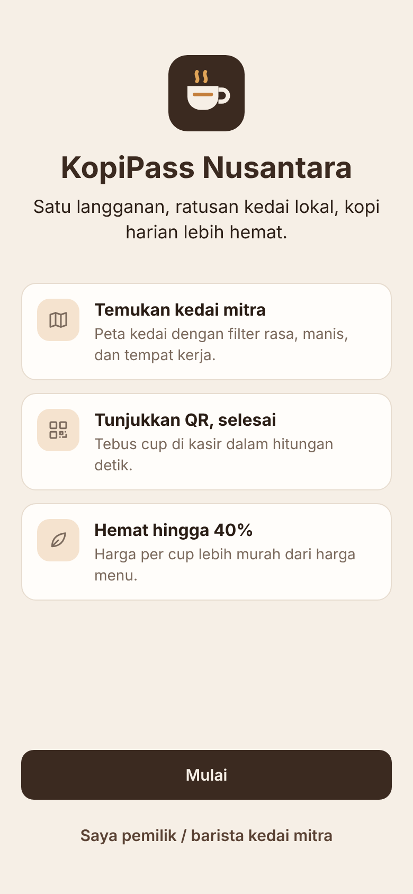 | 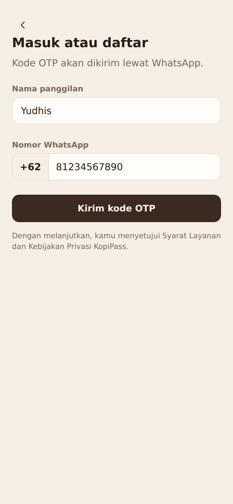 | 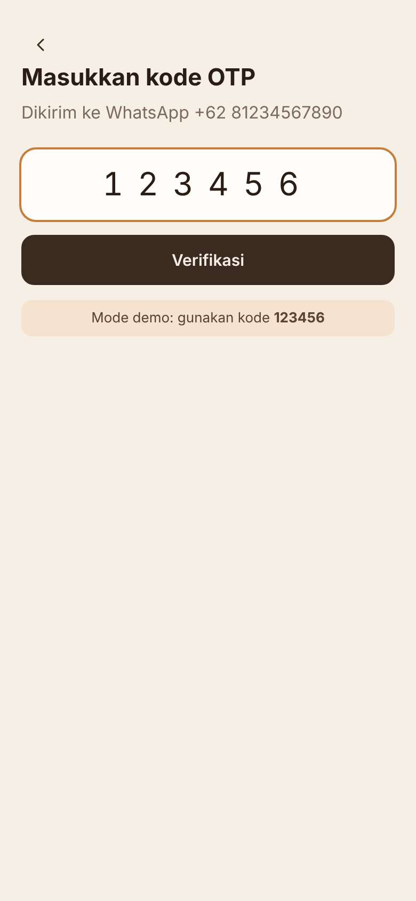 |

Halaman awal memperkenalkan KopiPass sebagai bagian dari **coffee culture Indonesia**: mendukung kedai lokal, menjelajahi rasa Nusantara (Gayo, Toraja, Kintamani, Flores, Java Preanger), punya kedai andalan, promo langsung dari kedai, dan lebih hemat setiap hari. Paket langganan **tidak** dipilih di sini; kamu bisa menjelajah dulu.

1. Tekan **Mulai jelajah**. (Pemilik atau barista kedai menekan **Saya pemilik / barista kedai mitra**, lihat [Bagian B](#bagian-b--mitra-kasir-dan-pemilik-kedai).)
2. Isi **nama panggilan** dan **nomor WhatsApp** tanpa angka 0 di depan, lalu tekan **Kirim kode OTP**.
3. Masukkan 6 digit kode OTP (demo: `123456`) dan tekan **Verifikasi**.

### 2. Pop-up promo dari kedai

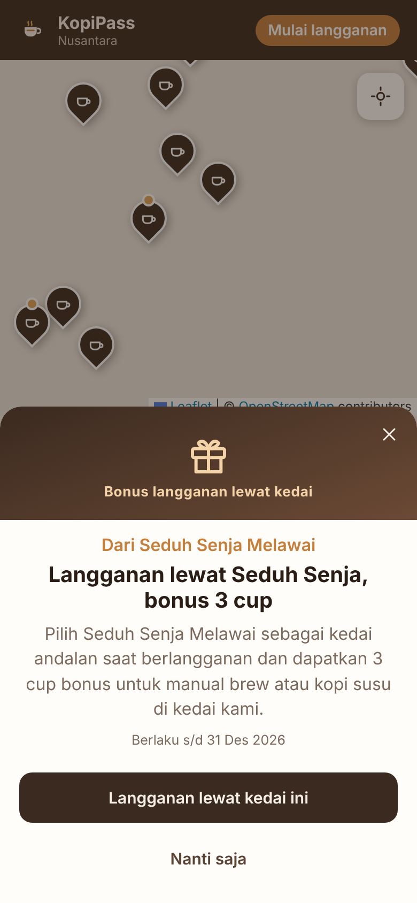

Kedai mitra bisa memasang promo yang muncul sebagai **pop-up** saat kamu membuka aplikasi. Pop-up muncul paling banyak sekali per sesi, dan setiap promo hanya muncul sekali. Promo dari kedai andalan dan favoritmu didahulukan.

- **Langganan lewat kedai ini** (untuk promo bonus langganan) langsung membuka pilihan paket dengan kedai tersebut sudah terpilih.
- **Klaim promo** menyimpan promo ke tab **Promo** untuk ditunjukkan ke kasir.
- **Nanti saja** menutup pop-up; promo tetap bisa dilihat di tab Promo.

### 3. Berlangganan lewat kedai andalan

| Pilih paket dan kedai andalan | Konfirmasi |
| :---: | :---: |
| 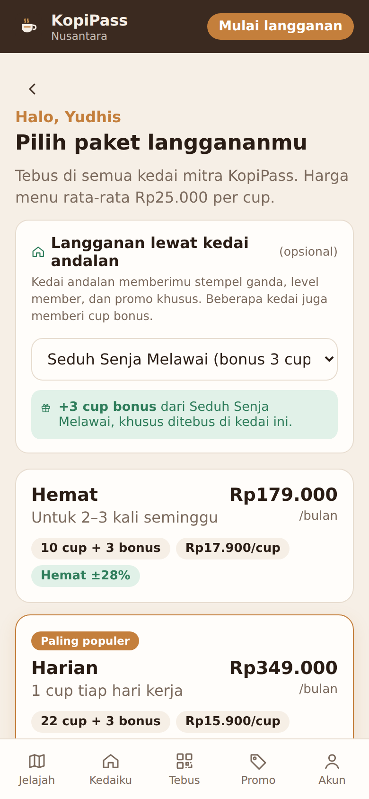 | 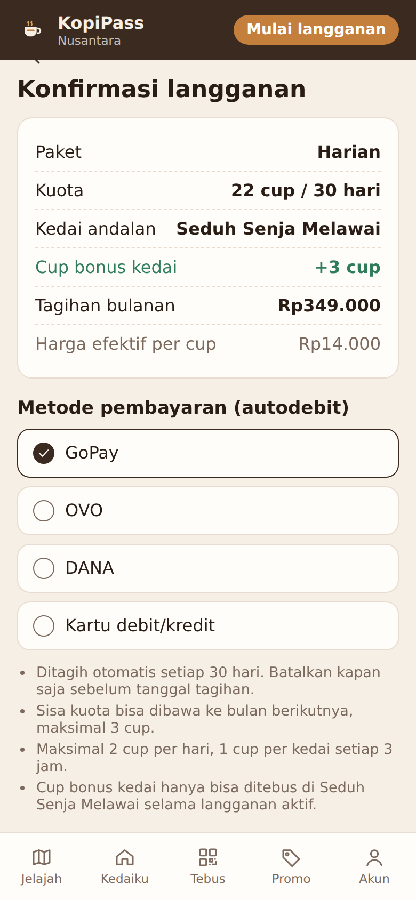 |

Langganan bisa dimulai dari tombol **Mulai langganan** di kanan atas, tab **Tebus**, tombol **Langganan lewat kedai ini** di kartu kedai, atau pop-up promo.

1. Di kotak **Langganan lewat kedai andalan**, pilih kedai yang paling sering kamu kunjungi (opsional). Kedai yang memberi promo ditandai "(bonus x cup)".
2. Pilih paket:

    | Paket | Kuota | Harga per bulan | Per cup |
    | --- | --- | --- | --- |
    | Hemat | 10 cup | Rp179.000 | Rp17.900 |
    | Harian (paling populer) | 22 cup | Rp349.000 | Rp15.900 |
    | Harian Plus | 30 cup | Rp449.000 | Rp15.000 |

3. Periksa ringkasan: kedai andalan dan **cup bonus kedai** (bila ada) tercantum. Pilih metode autodebit, lalu tekan **Bayar**.
4. Kuota tampil di kanan atas, misalnya **22 cup +3** (22 cup umum + 3 cup bonus kedai).

**Aturan penting:** maksimal 2 cup per hari, 1 cup per kedai setiap 3 jam, sisa kuota umum maksimal 3 cup dibawa ke bulan berikutnya, dan cup bonus hanya bisa ditebus di kedai pemberinya.

### 4. Kedaiku: kedai andalan, stempel, dan level

| Setelah berlangganan | Setelah beberapa kunjungan |
| :---: | :---: |
| 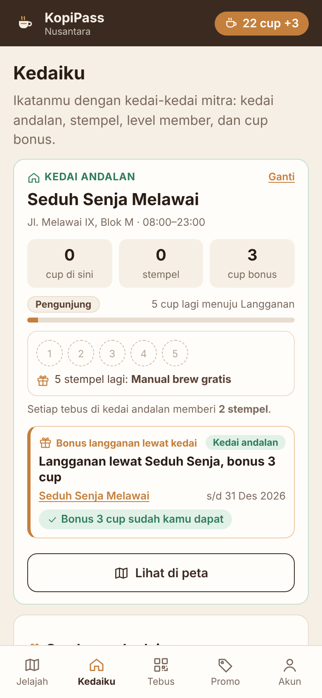 | 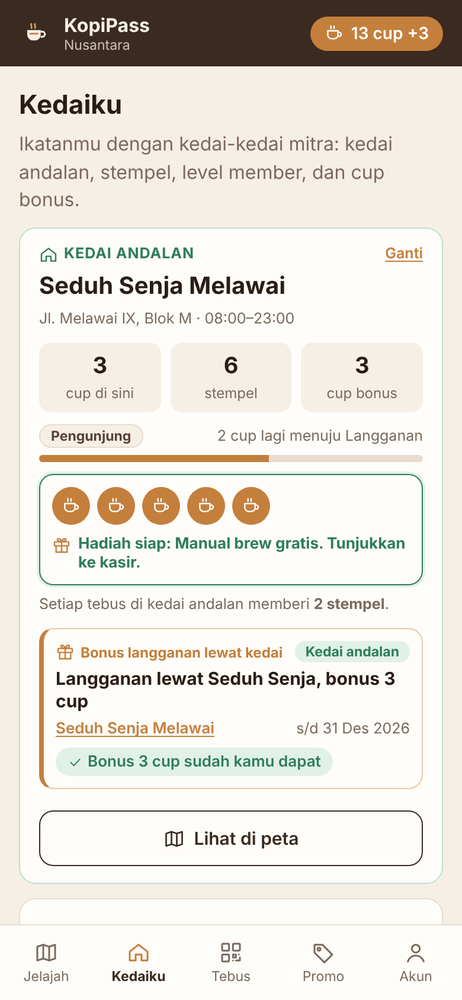 |

Tab **Kedaiku** adalah pusat ikatanmu dengan kedai-kedai mitra:

- **Kedai andalan**: jumlah cup di kedai itu, stempel, cup bonus, dan promo dari kedai tersebut. Setiap tebus di kedai andalan memberi **2 stempel**.
- **Level member** per kedai: **Pengunjung** (0–4 cup) → **Langganan** (5–14 cup) → **Sahabat Kedai** (15+ cup). Bilah kemajuan menunjukkan berapa cup lagi menuju level berikutnya.
- **Kartu stempel**: setiap kedai punya target dan hadiah sendiri (misalnya 5 stempel untuk *Manual brew gratis*). Saat penuh, kartu berwarna hijau bertuliskan **Hadiah siap**. Tunjukkan ke kasir saat menebus.
- **Cup bonus kedai**: daftar cup bonus yang kamu punya dan di kedai mana bisa dipakai.
- **Kedai favorit** dan **kartu stempel lainnya**, plus **riwayat tebus** di bagian bawah.
- **Ganti** kedai andalan kapan saja. Stempel dan level di kedai lama tetap tersimpan.

### 5. Menjelajah kedai di peta

| Peta, strip promo, dan daftar kedai | Detail kedai |
| :---: | :---: |
| 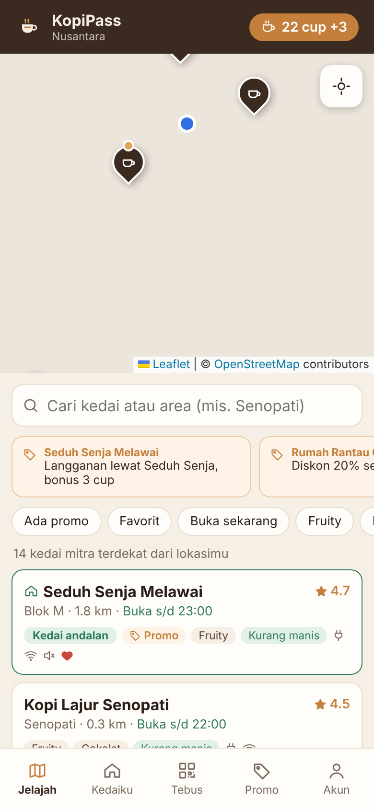 | 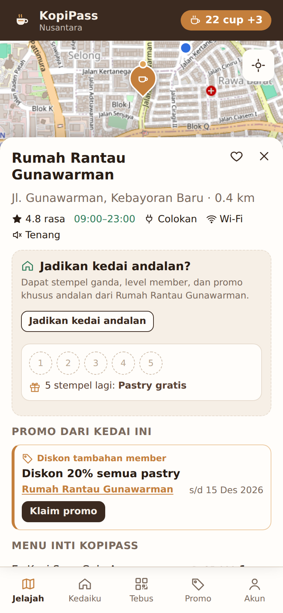 |

- **Pin cokelat** = kedai mitra, **pin hijau** = kedai andalanmu, **titik oranye** di pin = kedai sedang punya promo, **pin abu-abu** = sedang tutup.
- **Strip promo** di atas daftar menampilkan promo aktif; ketuk untuk membuka kedainya.
- Tombol **lokasi** menampilkan posisimu sebagai titik biru dan mengurutkan kedai dari yang terdekat. Kedai andalan selalu di urutan teratas.
- **Filter** bisa digabung: *Ada promo*, *Favorit*, *Buka sekarang*, profil rasa (*Fruity*, *Nutty*, *Cokelat*), *Bisa kurang manis*, *Ada colokan*, *Wi-Fi*, *Tenang*.
- Kartu kedai menampilkan badge **Kedai andalan**, **level** kamu di kedai itu, label **Promo**, dan hati merah bila favorit.

Detail kedai berisi:

- Tombol **hati** untuk menyimpan ke favorit.
- Kotak **kedai andalan**: tombol **Jadikan kedai andalan**, atau status kedai andalan beserta level, serta **kartu stempel** kedai tersebut.
- **Promo dari kedai ini** dengan tombol **Klaim promo**.
- **Menu inti KopiPass** (bisa ditebus dengan 1 cup).
- Tombol utama: **Tebus di kedai ini** jika sudah berlangganan, atau **Langganan lewat kedai ini** (beserta info cup bonus) jika belum.

### 6. Promo dari kedai

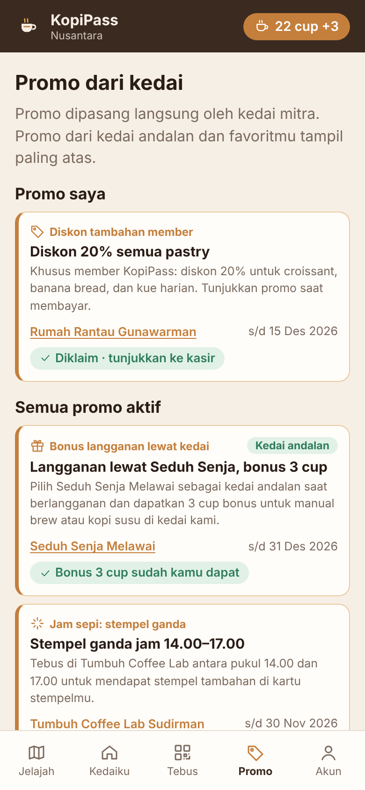

Tab **Promo** mengumpulkan semua promo aktif yang dipasang kedai mitra:

| Jenis promo | Cara memakai |
| --- | --- |
| Bonus langganan lewat kedai | Untuk calon pelanggan: tekan **Langganan lewat kedai ini** dan dapatkan cup bonus khusus kedai itu |
| Diskon tambahan member | Tekan **Klaim promo**, lalu tunjukkan saat membayar tambahan (pastry, biji kopi) |
| Jam sepi: stempel ganda | Otomatis: tebus pada jam yang tertera untuk stempel tambahan |
| Upgrade / item gratis | Klaim, lalu kasir menerapkannya saat kamu menebus |

Promo bertanda **khusus kedai andalan** baru bisa diklaim setelah kamu menjadikan kedai tersebut kedai andalan. Promo yang sudah diklaim pindah ke bagian **Promo saya**.

### 7. Menebus cup di kasir

| QR dan kode tebus | Simulasi kasir (demo) | Berhasil |
| :---: | :---: | :---: |
| 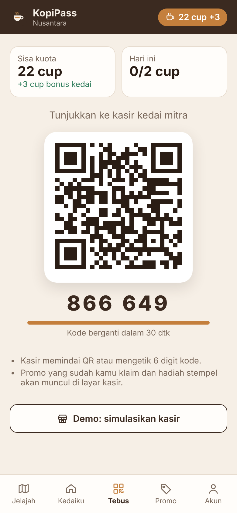 | 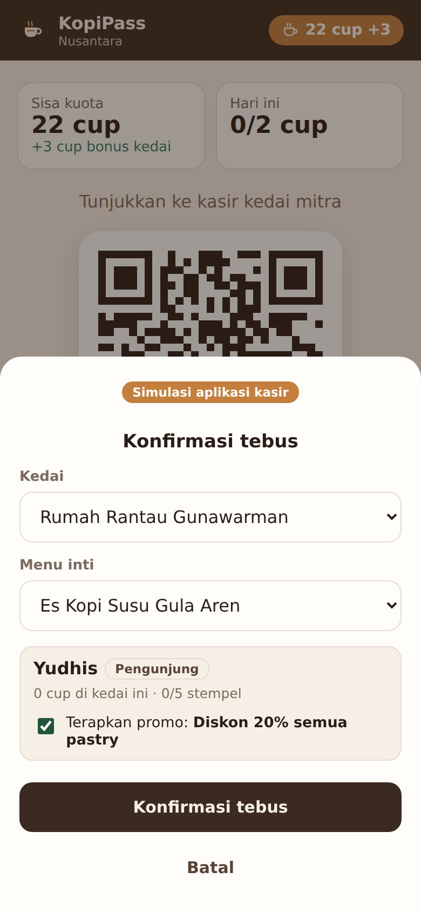 | 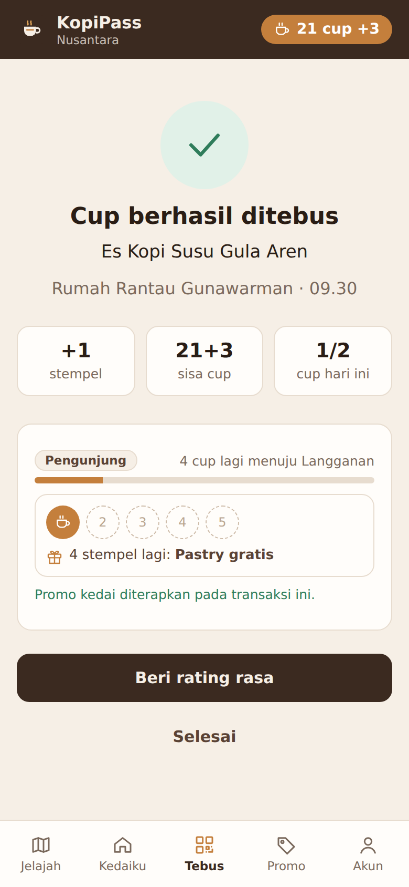 |

1. Di kasir, pesan salah satu **menu inti**.
2. Buka tab **Tebus**. Aplikasi menampilkan **QR** dan **kode 6 digit** yang berganti setiap **30 detik**.
3. Tunjukkan layar ke kasir. Di layar kasir muncul level, status kedai andalan, hadiah stempel, dan promo yang sudah kamu klaim. Sebutkan jika ingin memakai hadiah atau promo.
4. Setelah kasir mengonfirmasi, layar berubah menjadi **Cup berhasil ditebus**: stempel yang didapat, sisa cup, level, dan kartu stempel kedai itu.
5. Jika kamu punya cup bonus di kedai tersebut, cup bonus dipakai lebih dulu.

**Mencoba sendiri tanpa kasir:** tekan **Demo: simulasikan kasir**, pilih kedai dan menu, centang promo/hadiah bila ada, lalu tekan **Konfirmasi tebus**.

Belum berlangganan? Tab Tebus menampilkan tombol **Lihat paket langganan**.

### 8. Rating, riwayat, dan akun

| Rating rasa | Akun |
| :---: | :---: |
| 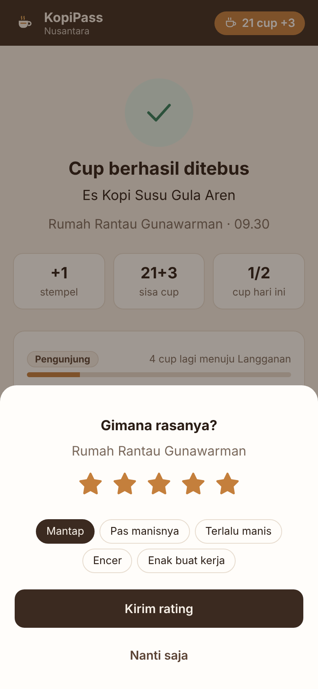 | 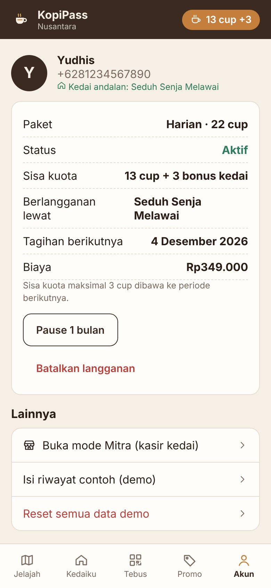 |

- Setelah menebus, tekan **Beri rating rasa**, pilih bintang dan tag, lalu **Kirim rating**.
- **Riwayat tebus** ada di bagian bawah tab Kedaiku, lengkap dengan stempel per transaksi.
- **Akun** menampilkan paket, status, sisa kuota umum dan bonus, kedai tempat kamu berlangganan, dan tanggal tagihan. Dari sini kamu bisa **Pause 1 bulan**, **Batalkan langganan**, membuka **mode Mitra**, mengisi **riwayat contoh** (demo), atau **reset data demo**.

---

## Bagian B — Mitra (kasir dan pemilik kedai)

Mode mitra dipakai pemilik dan barista di HP atau komputer kasir. Ada lima tab: **Tebus**, **Promo**, **Pelanggan**, **Laporan**, dan **Atur**.

### Masuk

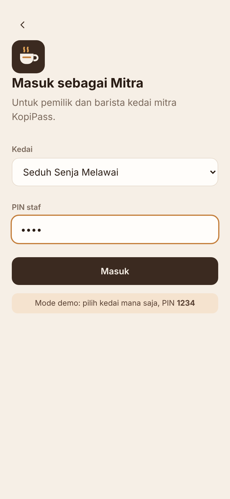

Dari halaman awal tekan **Saya pemilik / barista kedai mitra** (atau **Akun → Buka mode Mitra**), pilih **kedai**, masukkan **PIN staf** (demo: `1234`), lalu **Masuk**.

### Tebus: konfirmasi dengan panel pelanggan

| Panel pelanggan | Berhasil |
| :---: | :---: |
| 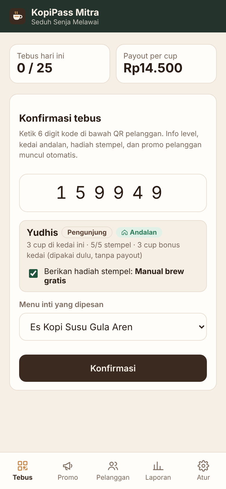 | 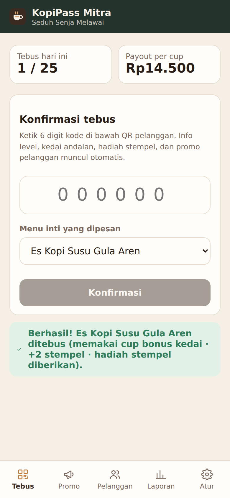 |

1. Ketik **6 digit kode** dari layar pelanggan.
2. **Panel pelanggan** muncul otomatis: nama, level di kedaimu, badge **Andalan**, stempel, dan cup bonus kedai.
3. Jika hadiah stempel siap dan pelanggan memintanya, centang **Berikan hadiah stempel**. Jika pelanggan punya promo yang diklaim, centang **Terapkan promo**.
4. Pilih **menu inti**, tekan **Konfirmasi**, lalu buat minuman sesuai standar.
5. Pesan hijau merangkum transaksi: memakai cup bonus atau kuota umum, jumlah stempel, hadiah, dan promo. Pesan merah menjelaskan alasan gagal (lihat [SOP-03](SOP.md#sop-03-tebus-cup-di-kasir)).

### Promo: buat promo dan pop-up

| Daftar promo | Membuat promo baru |
| :---: | :---: |
| 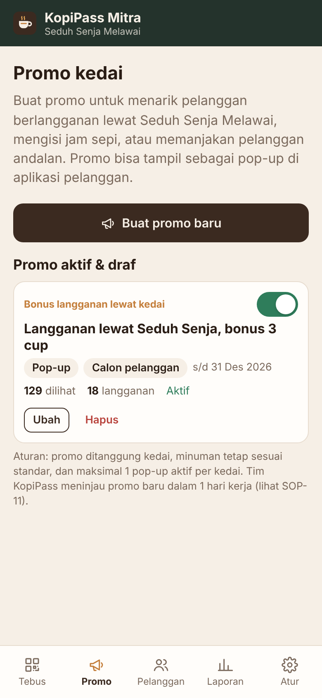 | 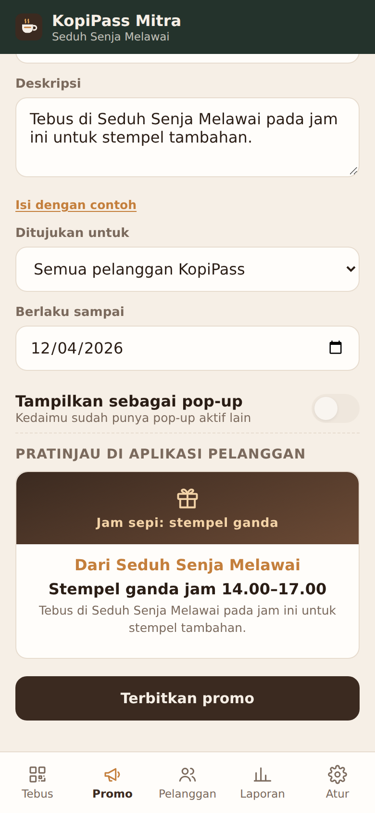 |

1. Tekan **Buat promo baru**.
2. Pilih **jenis promo**: *Bonus langganan lewat kedai* (1–5 cup bonus, khusus pelanggan baru), *Diskon tambahan member*, *Jam sepi: stempel ganda* (pilih jamnya), atau *Upgrade / item gratis*.
3. Isi **judul** dan **deskripsi** (atau tekan **Isi dengan contoh**), pilih **ditujukan untuk** (*semua pelanggan* atau *hanya pelanggan andalan*), dan tanggal **berlaku sampai**.
4. Nyalakan **Tampilkan sebagai pop-up** bila ingin promo muncul saat pelanggan membuka aplikasi (maksimal 1 pop-up aktif per kedai).
5. Periksa **pratinjau**, lalu tekan **Terbitkan promo**.
6. Di daftar promo, pantau jumlah **dilihat** dan **diklaim/langganan**, nyalakan/matikan promo dengan sakelar, **Ubah**, atau **Hapus**.

Promo ditanggung kedai, termasuk cup bonus langganan (tanpa payout). Aturan lengkap ada di [SOP-11](SOP.md#sop-11-promo-mitra-dan-pop-up).

### Pelanggan, laporan, dan pengaturan

| Pelanggan | Laporan | Atur |
| :---: | :---: | :---: |
| 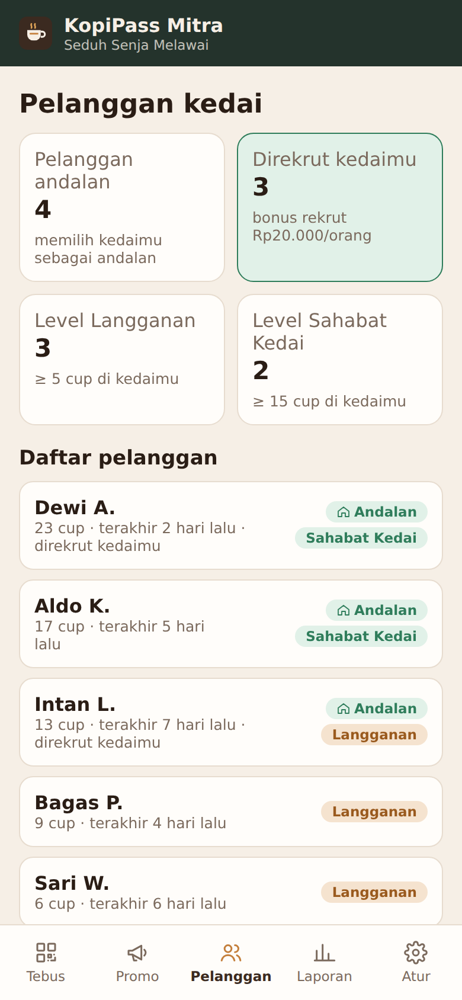 | 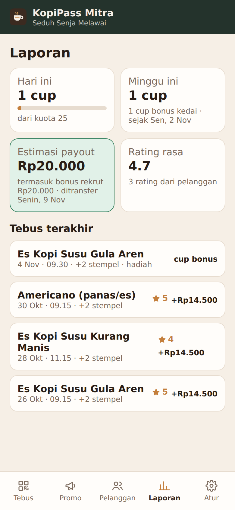 | 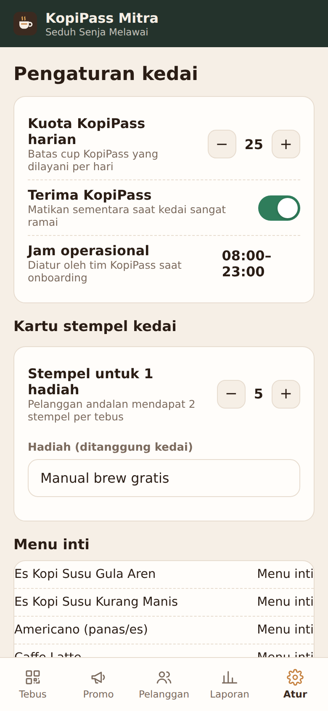 |

- **Pelanggan**: jumlah pelanggan andalan, pelanggan yang **direkrut kedaimu** (bonus rekrut Rp20.000 per orang, usulan), jumlah per level, dan daftar pelanggan beserta level dan kunjungan terakhir.
- **Laporan**: tebus hari ini dibanding kuota harian, tebus minggu ini (termasuk jumlah cup bonus), **estimasi payout** (Rp14.500 per cup kuota umum, Rp0 untuk cup bonus, plus bonus rekrut), rating rasa, dan daftar tebus terakhir.
- **Atur**: kuota KopiPass harian, sakelar **Terima KopiPass**, **kartu stempel kedai** (jumlah stempel per hadiah dan nama hadiah), serta daftar menu inti.

---

## Bagian C — Tampilan Windows

| Pop-up promo | Peta dengan detail kedai andalan | Kedaiku |
| :---: | :---: | :---: |
| 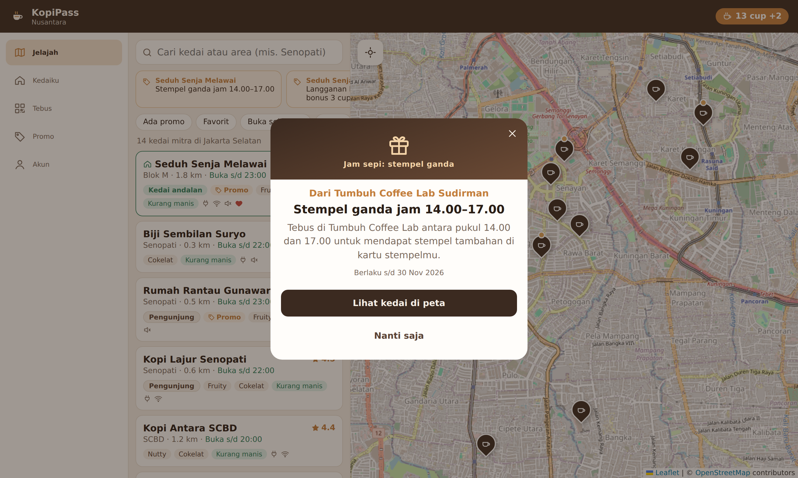 | 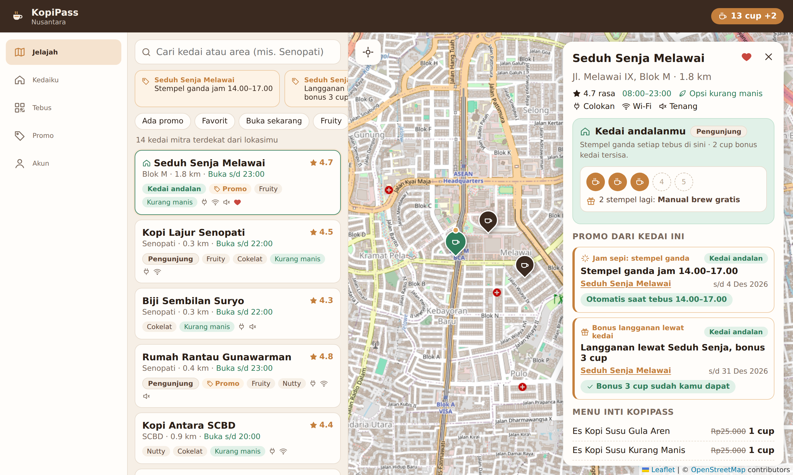 | 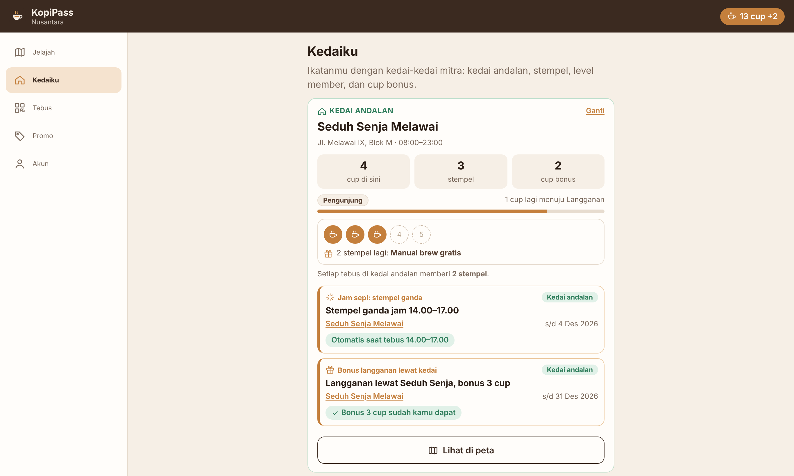 |

Di Windows (dan layar lebar), menu pindah ke sisi kiri, daftar kedai tampil di samping peta, dan detail kedai muncul sebagai panel di kanan. Semua fungsi sama dengan versi ponsel.

---

## Pertanyaan umum dan solusi masalah

| Masalah | Solusi |
| --- | --- |
| Kenapa paket tidak muncul di awal? | KopiPass mengajakmu menjelajah kedai dulu. Paket bisa dipilih kapan saja dari **Mulai langganan**, tab Tebus, kartu kedai, atau pop-up promo. |
| Apa bedanya kuota umum dan cup bonus? | Kuota umum bisa ditebus di semua kedai mitra. Cup bonus berasal dari promo kedai dan hanya bisa ditebus di kedai itu. |
| Stempel saya hanya bertambah 1 | Stempel ganda hanya di kedai andalan. Jadikan kedai itu kedai andalan dari kartu kedai atau tab Kedaiku. |
| Promo tidak bisa diklaim | Promo bertanda khusus kedai andalan memerlukan kedai itu sebagai kedai andalanmu. Promo bonus langganan hanya untuk calon pelanggan baru. |
| Pop-up tidak muncul lagi | Setiap promo pop-up hanya muncul sekali. Lihat semua promo di tab **Promo**. |
| Peta abu-abu dan tidak ada jalan | Peta membutuhkan internet. Pin kedai tetap tampil walau peta belum termuat. |
| Titik biru lokasi tidak muncul | Izinkan akses lokasi di pengaturan ponsel atau Windows. |
| "Kode sudah kedaluwarsa" di kasir | Kode berlaku 30 detik. Tunjukkan kode terbaru. |
| "Kuota umum habis. Cup bonus pelanggan hanya berlaku di kedai lain" | Kuota umum habis dan cup bonusmu berasal dari kedai lain. Tebus di kedai pemberi cup bonus. |
| Data di HP dan laptop berbeda | Di prototipe, data tersimpan per perangkat. Sinkronisasi tersedia setelah backend aktif. |
| Ingin mengulang demo dari awal | **Akun → Reset semua data demo**. |

Butuh bantuan lain? Hubungi pemilik proyek melalui halaman GitHub [yudhis7](https://github.com/yudhis7).
